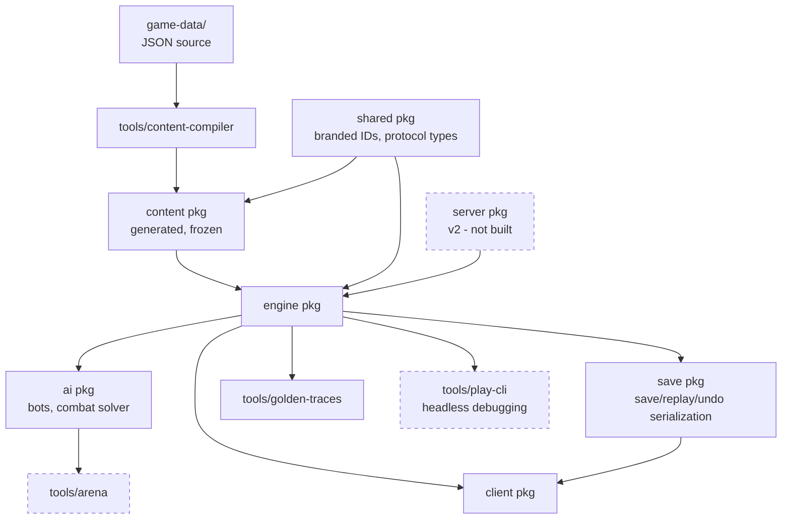
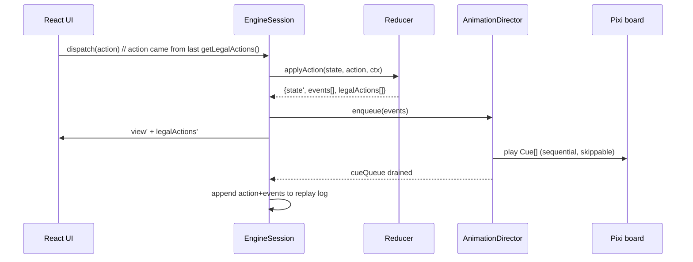
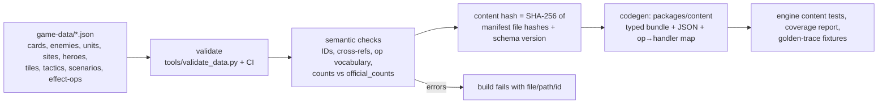
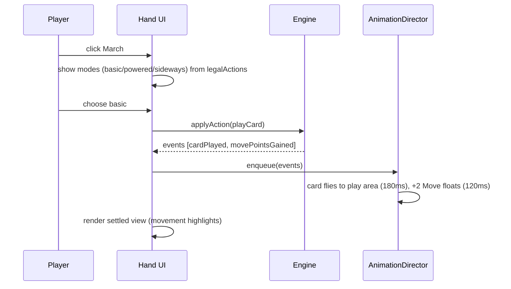

# 12 — Miniknight Technical Architecture

**Status:** proposed · **Owner:** architect · **Last updated:** 2026-10-24
**Scope:** engine, content pipeline, client, persistence, testing, build plan.
**Companions:** [`13-ai-opponents.md`](./13-ai-opponents.md), [`10-feasibility-analysis.md`](./10-feasibility-analysis.md), [`11-mvp-scope.md`](./11-mvp-scope.md) (authoritative for what ships in v1.0) · **Rules source of truth:** [`../research/02-rules-core.md`](../research/02-rules-core.md) (published 2026-10-24: state machines §1, combat §7, end-of-turn pipeline §15.1, timing/priority/undo §19; page citations below are from the extracted rulebooks directly).

---

## 1. Executive summary

**Build Miniknight as a TypeScript monorepo with a pure, deterministic rules engine, a React shell, and an SVG/DOM hex board (PixiJS as an optional upgrade behind a renderer interface).** Ship web-first; package desktop with Tauri v2 later (ADR-003, `17-platform-analysis.md`). Do not build a Rust engine, Godot project, or Unity project for T1/T2.

Five decisions drive everything else:

| # | Decision | Rationale (short) |
|---|---|---|
| D1 | **TypeScript everywhere**, strict mode, no `any` in engine | One language across engine, content compiler, UI, bots, arena, tools; JSON-native content; fastest rules iteration. Upstream rewrote its TS engine to Rust only after adding large-scale RL training — a requirement Miniknight does not have (§3.2). |
| D2 | **Pure reducer + event sourcing**: `reduce(state, action) → {state, events}`; state is a serializable value | Replay, undo, save/resume, network-ready, AI search and deterministic tests all fall out of one property. |
| D3 | **Legal actions are the only UI contract**: every enabled control comes from `getLegalActions(state, player)`; the client holds zero rules | Eliminates the client/server rule drift that upstream's own effect docs call out as a recurring bug class (§5.5). |
| D4 | **Content is data, not code**: `game-data/` → schema-validated build → typed content bundle injected into the engine | `game-data/` is owned by data-extractor; content updates must not touch engine logic; balance passes stay in data diffs. |
| D5 | **Solo-only T1; local hotseat is T2 (v1.1); no PvP, no realtime netcode** | Matches [`11-mvp-scope.md`](./11-mvp-scope.md) §1/§5 and the brief's solo/co-op reduction axis. Save-file async play is the cheap multi-hero path later; the engine stays server-ready. |

**The v1.0 ship target is T1 "First Conquest"** (per [`11-mvp-scope.md`](./11-mvp-scope.md) and Lead direction): solo web game, 3 rounds Day/Night/Day, fixed authored 4-tile wedge, 1 city level 4, dummy clock, ~40 card definitions, 1 hero (2nd as stretch), 20–30 min, no hotseat. **T2 "Classic"** is the follow-on milestone: official Solo Conquest shape (6 rounds, 11 tiles, city levels 5/8 — `MK 2012 Rulebook, Scenario Book p.17`; `MKUE Rulebook, p.19`), 2 heroes (4 stretch), hotseat, larger content pool, 45–75 min. The round/day-night loop, tactic selection, dummy-player turn, scenario-end triggers and scoring are *rules*; the architecture treats them as first-class engine states (§5.2) and scenario data, not ad-hoc scripting. Tier mapping in §12.4.

**Estimated critical path:** **T0 spike 2 ew → T1 First Conquest 9–13 ew incremental → T2 Classic 25 ew total** (§12.4–§12.5). A 2-engineer team reaches T1 in roughly 8–10 calendar weeks from zero and T2 in 16–20 weeks including buffer. Optional Tier-1 bot adds ~4–6 ew (`13-ai-opponents.md` §8).

---

## 2. Scope constraints and what they imply architecturally

Miniknight is a *reduced* adaptation. The reduction axes in `00-brief.md` §5, the T1 manifest in [`11-mvp-scope.md`](./11-mvp-scope.md) §3, and the T1→T2 tier plan translate into hard architectural requirements, not just design preferences:

| Reduction axis (brief §5) | Miniknight choice (T1 v1.0 / T2 Classic) | Architectural consequence |
|---|---|---|
| Solo/co-op vs competitive | **Solo-only T1 (v1.0)**; local hotseat/shared-screen 2-player at T2/v1.1; no PvP, no netcode | Rules engine keeps PvP-capable concepts (interactive windows, defender reaction) behind reserved fields/flags but does not implement them. Save/replay format is the async path. |
| Heroes 2–4 vs 7 (8 incl. 2026 expansion) | **T1: 1 hero (2nd as stretch); T2: 2 heroes (4 stretch)** | Hero is content: `HeroDef` with starting deck/stats/skills. Engine has no hero-specific branches. |
| Map: fixed/smaller vs full deck | **First Conquest: fixed authored 4-tile wedge** (1 start + 2 countryside + 1 city); **Classic preset: 11 tiles** per Solo Conquest rules | `ScenarioDef` owns tile multiset, map shape, placement mode (`authored` for First Conquest, `shuffledDeck` for Classic). Tile order/placement is engine state; reveal is a rules action. |
| Cards: subset vs all | **T1: ~40 card definitions** (16-card starting deck; 12 Advanced Actions; 6 Spells; 4 Artifacts; 6 Units; ~6 reachable Skills/hero), 10 regular + 2 city-garrison enemies, 6 site types. **T2: ~90–110 definitions** per `10-feasibility` option B | Effect DSL covers only used effects, with an explicit registry and content-validation gate. Target ≤40 atomic effect types (§6). Content is the schedule tail — cap it hard. |
| One tuned scenario vs all | **T1: First Conquest only. T2: adds Classic preset** (official Solo Conquest shape, reduced pool); both are data | Scenario rules (setup, end triggers, scoring table, dummy config) are data + a small `ScenarioHooks` interface; no scenario code paths in the reducer. First Conquest preset authored in `game-data/scenarios.json` via data-extractor. |
| Combat: full phases vs streamlined | **Keep the four phases** (Ranged/Siege → Block → Assign Damage → Attack) because card text depends on them; simplify enemy/site variety, not the phase machine | Combat is an explicit sub-state machine (`CombatState`) with its own legal-action families and undo boundaries (§5.7). |
| Session 30–60 min | **T1 First Conquest 20–30 min; T2 Classic 45–75 min** (`11-mvp-scope` §2) | Persistence must survive real life: autosave at turn boundaries, one active run slot + replay log, resume-on-load. |

> ⚠️ **Authority note:** where this document and `11-mvp-scope.md` disagree on *scope*, `11` wins. §14 lists the residual decisions plus cross-document mismatches found while writing this doc (Classic preset round count; a rulebook page citation; content-envelope wording).

---

## 3. Stack choice

### 3.1 Options compared

Scoring: ◎ strong, ○ adequate, △ weak/expensive, ✕ disqualifying for Miniknight.

| Criterion (weight) | TS + React/Pixi (proposed) | Godot 4 | Unity | Rust core + TS shell |
|---|---|---|---|---|
| Rules-engine iteration speed (25%) | ◎ typed unions + Vitest, instant workspaces | △ GDScript/C# engine logic, weaker test ecosystem | △ C# fine, heavy editor/build loop | ✕ two-language tax on every rules change |
| Determinism/replay/save/undo (20%) | ◎ pure reducer, JSON state, seeded RNG | △ custom serialization, harder headless tests | △ same | ◎ but FFI-boundary serialization on every step |
| Hex + card presentation & animation (20%) | ◎ Pixi board + DOM cards; huge ecosystem | ◎ built-in 2D editor/animation | ◎ mature, asset store | ◎ (UI is unchanged; it's still TS) |
| AI/arena/tooling (10%) | ◎ same language, `worker_threads`, Node CLIs | ✕ slow headless games, poor parallel tooling | △ C# tools okay but heavier | ◎ native speed, best for RL |
| Web distribution (10%) | ◎ one build, instant playtests | △ web export size/perf limits | △ weak web export | ○ WASM boundary, bigger build |
| Hiring/community for a 2D indie game (10%) | ◎ largest | ○ good | ◎ good | △ Rust game/UI devs rarer |
| Content pipeline fit (`game-data/`) (5%) | ◎ JSON → validator → TS types | △ JSON via `FileAccess`, no type codegen | ○ JSON + ScriptableObjects | ◎ serde, but split pipeline |

### 3.2 Decision and trade-offs

**Choose TS + React with an SVG/DOM board (Pixi optional).** The engine is the risk in this project, not the renderer, and TypeScript gives the cheapest possible loop for rules: edit a card definition, run one test, see the whole game in a headless trace in milliseconds. `game-data/` already ships validated JSON; the codegen/typegen step is ~2 engineer-weeks and eliminates an entire class of "content doesn't match engine" bugs.

The honest cost of this choice: JS performance ceilings, GC pauses, and the need for discipline around determinism (iteration order, floating point). All three are handled by explicit rules in §5.3 and performance budgets in §11; none of them are on the critical path at Miniknight's scale (a turn is tens of actions, not thousands).

**Why not Rust core now.** The upstream project is the best evidence available for the rules model, and its history is instructive: it built a complete TypeScript monorepo first (≈7 weeks, 1,062 commits), then scaffolded a Rust engine in four days and let the Rust workspace grow for eight months, deleting the TS engine; the migration was affordable because the rules had already been encoded once and was safeguarded by TS-generated golden traces replayed as parity tests (`../research/05-digital-precedents.md` §1.2–§1.3). Rust buys throughput for the RL stack (vectorized env, PyO3) and strictness on a very large effect surface, but it also imposed a two-language toolchain and a permanent parity burden. Miniknight needs neither: ~40–110 cards, one scenario, no ML in-product. Encoding the rules once in TypeScript, with golden traces and a serialized engine protocol, gets us most of the future-proofing at a fraction of the toolchain cost — and makes a later Rust port mechanical rather than a rewrite from scratch.

**Escape hatch, and its trigger.** Keep the engine behind a serialized protocol (`GameState`, `Action`, `GameEvent`, `LegalAction`, all JSON-safe, versioned). If measured thresholds are breached — e.g. arena throughput < 2,000 games/hour/core, or `getLegalActions` p95 > 15 ms on a low-end laptop, or AI search becomes a shipped feature that needs > 100k rollouts/game — port *only* the engine to Rust behind the same protocol. The client, content bundle and replay format do not change. This is a cheap option to buy because it constrains nothing else (see D1 in §1 and `13-ai-opponents.md` §3.3 for the AI-driven case).

**Why not Godot/Unity.** They optimize for content-heavy 3D/2D pipelines and built-in tools, and both make *headless rules testing* (the thing this game needs most) worse. Godot's web export is also a poor fit for a browser playtest loop, and neither gives us deterministic replay/AI tooling for free. If the project later pivots to a heavy animated 3D presentation, Godot becomes defensible; it is the wrong tool for a rules-heavy 2D card game with an AI/test substrate.

### 3.3 Concrete toolchain (T1/T2)

| Concern | Choice | Notes |
|---|---|---|
| Language | TypeScript 5.x, `strict`, `noUncheckedIndexedAccess` | Engine package: no DOM types; `lib: ES2022` only |
| Runtime | Node 22 LTS (+ modern evergreen browsers) | Node for tests, arena, content build; same code in browser |
| Package manager | pnpm workspaces | matches repo conventions; fast, strict |
| Bundler | Vite (client), tsup/esbuild (packages) | library builds emit ESM + d.ts |
| UI | React 19 + Zustand (client-local UI state only) | game state lives in engine, not in React state |
| Board rendering | **SVG/DOM first** (tiles, tokens, highlights, camera via CSS transforms) | v1 scale is small; `BoardRenderer` interface allows a PixiJS v8 canvas upgrade if profiling demands it |
| Cards/HUD | React DOM + CSS | crisp text, localization, accessibility; card art via sprite atlas |
| Content | `game-data/` JSON → validator + typegen → frozen TS/JSON bundle | schema v1.0.0 (`game-data/schema.md`); manifest file hashes → content hash |
| Validation | zod (schemas), dependency-cruiser (boundaries) | CI gates |
| Tests | Vitest, fast-check (property), Playwright (E2E) | headless first |
| Lint/format | ESLint flat config + Prettier | `no-floating-promises`, `consistent-type-imports` |
| Desktop (later) | Tauri 2 | reuse web build, Steam-friendly, small |
| Error reporting (prod) | Sentry (client) + local replay attachment | repro via action log, not screenshots |
| Docs | this repo; ADRs in `docs/adr/` | every irreversible choice gets a one-page ADR |

---

## 4. System architecture

### 4.1 Runtime topology

```mermaid
flowchart LR
    subgraph Browser
        UI[React shell<br/>cards, HUD, menus] --> AD[Animation Director]
        PIXI[Pixi board<br/>tiles/tokens/camera] --> AD
        AD --> CS[Client Session<br/>subscribe, send action]
    end
    subgraph Engine[Pure TS engine - no I/O]
        R[Reducer<br/>applyAction] --> E[Event stream]
        E --> L[Legal action enumerator]
        R --> V[Player view projection]
    end
    CS -->|Action| R
    E -->|GameEvent[]| CS
    L -->|LegalAction[]| UI
    V -->|PlayerView| UI
    PIXI -.->|read-only projection| CS
    subgraph Tools
        ARENA[Arena / bots] --> R
        TRACE[Golden-trace runner] --> R
        CONTENT[Content compiler] --> R
    end
```

The engine has **no browser APIs, no timers, no I/O**. Anything ambient (time, randomness, network) is injected at the edge. This is what makes the same code run in the browser, in Node tests, in the arena, and — later — on a server.

### 4.2 Package/module dependency graph



**Dependency rules (enforced in CI):**

1. `engine` may import only `content` + `shared`. No React, Pixi, DOM, Node built-ins, network, or `Date`/`Math.random`.
2. `client` may import `engine`, `shared`, `save` — but **never** `content`'s rules data for gameplay decisions. Presentation-only content (labels, icon IDs, card names) is exposed through a separate `content/presentation` entry point.
3. `ai` depends on `engine` only, plus an injectable `BotView` projection; `tools/*` may depend on anything.
4. Generated content is never hand-edited; CI fails if `git diff --exit-code` after regeneration.
5. No circular package dependencies; dependency-cruiser runs on PR.

### 4.3 Repository layout

```
miniknight/
  game-data/                    # owned by data-extractor (JSON + schema.md/README)
  packages/
    shared/                     # branded IDs, CardId/EnemyId/etc., protocol envelope, util types
    content/                    # generated content bundle + presentation mapping (committed)
    engine/                     # reducer, legal actions, effects, projections, invariants
      src/state/ action/ events/ effects/ rules/ combat/ movement/ sites/ scenario/
      src/__tests__/unit/ golden/ property/
    save/                       # SaveFile codec, replay codec, migrations
    ai/                         # combat solver + heuristic bot + arena protocols (see doc 13)
    client/                     # React shell
      src/board/ (Pixi)  src/hand/ src/combat/ src/hud/ src/animation/ src/screens/
  tools/
    content-compiler/           # game-data -> packages/content
    golden-traces/              # fixture runner + regenerate script
    arena/                      # headless bot matches (doc 13)
    play-cli/                   # text-mode play / step debugger
  docs/ design/ research/ adr/
```

### 4.4 One-game-lifetime data flow



State advances **before** animation; animation replays a diff the UI can always skip. If a player closes the tab mid-animation, no state is lost. That single rule removes the most common class of desync bugs in card games.

---

## 5. Deterministic rules engine

### 5.1 Core design rules (non-negotiable)

1. `GameState` is a **plain JSON-serializable value**. No classes, no Maps with object keys, no functions, no `undefined` in serialized positions.
2. Only the reducer mutates state, and it does so by returning a new value. Dev builds `deepFreeze` states to catch accidental mutation.
3. The reducer is **pure**: same `(state, action)` → byte-identical state and events. It receives an `RngState` through state, never a global.
4. Every user-visible outcome is a **`GameEvent`** appended to the action result. UI, logs, replays, analytics and the animation layer consume events — never internal mutations.
5. **Legal actions are computed by the engine** and every returned action is guaranteed to apply successfully (`getLegalActions` ⊆ `applyAction` success set — enforced by property test §10).
6. Any UI choice that exists only as presentation (hover, ordering of animations, card fan layout) never consults rules logic. If it needs a number, the engine returns it (cost preview, damage preview) — see §5.5.

### 5.2 State model (TypeScript sketch)

```ts
// packages/shared/src/ids.ts — branded, string-serializable IDs
export type Brand<T, B extends string> = T & { readonly __brand: B };
export type PlayerId = Brand<string, "PlayerId">;   // "p1"
export type CardId = Brand<string, "CardId">;       // "basic.march"
export type CardInstanceId = Brand<string, "CardInstanceId">; // "p1:hand:03"
export type EnemyDefId = Brand<string, "EnemyDefId">;
export type EnemyInstanceId = Brand<string, "EnemyInstanceId">;
export type TileId = Brand<string, "TileId">;       // "countryside.03"
export type SiteDefId = Brand<string, "SiteDefId">;
export type UnitDefId = Brand<string, "UnitDefId">;
export type UnitInstanceId = Brand<string, "UnitInstanceId">;
export type SkillDefId = Brand<string, "SkillDefId">;
export type Hex = { readonly q: number; readonly r: number }; // axial

export type GamePhase = "setup" | "round" | "gameEnd";
export type RoundPhase = "roundPrepare" | "tactics" | "playerTurns" | "roundEnd";
export type TimeOfDay = "day" | "night";

export interface GameState {
  readonly schemaVersion: 3;
  readonly contentHash: string;           // pins rules+card definitions to replays/saves
  readonly gameId: string;
  readonly seed: number;                  // u32, display/audit only
  readonly scenarioId: string;
  readonly rulesetId: "mkue2018" | "mk2012" | "miniknight-v1";

  readonly phase: GamePhase;
  readonly round: number;                 // 1-based, ≤ scenario.roundLimit
  readonly timeOfDay: TimeOfDay;
  readonly roundPhase: RoundPhase;
  readonly turn: TurnState;
  readonly players: readonly PlayerState[]; // fixed order by seat
  readonly map: MapState;
  readonly offers: OffersState;
  readonly decks: SharedDecksState;       // artifacts/spells/AA/wounds/enemy piles
  readonly source: SourceState;
  readonly combat: CombatState | null;
  readonly pending: PendingChoice | null; // blocks everything until resolved
  readonly effectStack: readonly QueuedEffect[]; // non-empty only mid-resolution
  readonly actionEpoch: number;           // stale-action guard, see LegalActionSet
  readonly rng: RngState;                 // seed+counter+streams, see §5.3
}

export interface TurnState {
  readonly activePlayer: PlayerId | null; // null during tactics/round prep
  readonly roundOrder: readonly PlayerId[];
  readonly turnNumber: number;            // within round
  readonly turnKind: "none" | "regular" | "resting" | "forfeit";
  readonly step: "turnStart" | "special" | "movement" | "action" | "endOfTurn";
  // combat is a separate GameState.combat sub-machine, not a turn step (see 02 §1.5)
  readonly actionsTakenThisTurn: number;   // rules cap: one action (MKUE p.6)
  readonly movementPointsRemaining: number;
  readonly influencePointsRemaining: number;
  readonly flags: TurnFlags;              // bitfield: playedCard, rested, combatted, ...
  readonly endOfRoundAnnouncedBy: PlayerId | null;
  readonly finalTurnsPending: readonly PlayerId[]; // scenario-end / end-of-round bookkeeping (02 §1.3)
  readonly pendingInteractivePlayers: readonly PlayerId[]; // v2 PvP/co-op windows
}

export interface PlayerState {
  readonly id: PlayerId;
  readonly heroId: string;
  readonly seat: number;
  readonly level: number;
  readonly fame: number;                  // may go negative from penalties
  readonly reputation: number;            // -X..+X, drives interaction modifier
  readonly position: Hex | null;          // null while on portal/city-card (v2)
  readonly hand: readonly CardInstanceId[];
  readonly deck: readonly CardInstanceId[];        // top = index 0
  readonly discard: readonly CardInstanceId[];
  readonly playArea: readonly CardInstanceId[];
  readonly crystals: Readonly<Record<BasicManaColor, number>>; // 0..3
  readonly pureMana: readonly ManaToken[];          // expires end of turn
  readonly commandTokens: { total: number; used: number };
  readonly units: readonly UnitInstance[];
  readonly skills: readonly SkillInstance[];
  readonly tacticId: string | null;
  readonly flags: PlayerFlags;            // bitfield for cross-turn state
}

export interface MapState {
  readonly tiles: readonly PlacedTile[];  // tileId, origin Hex, rotation, revealed
  readonly tileDeck: readonly TileId[];   // remaining; scenario sets mode (shuffled deck / authored)
  readonly sites: readonly SiteState[];   // ownership shields, burned, garrison
  readonly enemyTokens: readonly MapEnemyToken[]; // rampaging tokens with instance ids
}

export interface CombatState {
  readonly kind: "enemies" | "pvp";       // pvp reserved for v2
  readonly phase: "rangedSiege" | "block" | "assignDamage" | "attack";
  readonly enemies: readonly CombatEnemy[]; // def id + modifiers + isDefeated/blocked
  readonly accumulated: { attack: AttackPool; block: BlockPool };
  readonly assignments: readonly AttackAssignment[]; // target-first, incremental
  readonly damageQueue: readonly EnemyAttack[];     // unblocked, pending assignment
  readonly rewardPending: RewardOffer | null;
  readonly context: "open" | "fortifiedSite" | "city" | "adventureSite";
}
```

Notes that matter for implementation:

* **Instances vs definitions.** Definition IDs (`"enemy.orcMarauder"`) are content; instance IDs identify a specific token/card in this game (`"e2"`, `"p1:deck:07"`). All runtime references are instance IDs; definitions are looked up immutable and never mutated. This is what makes replay across content versions debuggable.
* **Bitfields only for booleans**, not for anything the rules branch on in a way designers tune. `PlayerFlags` is a `Readonly<Record<string, boolean>>` in dev and bitfield in release if profiling demands; start readable.
* **`pending` is a single blocking choice**, matching the upstream lesson that a pile of `pending*` fields on the player is unmaintainable (`packages/engine-rs/CLAUDE.md` §Key Design Decisions). The sequence is always: action → resolve effects → maybe need a choice → engine pauses with `pending` → next action is `ResolveChoice`. Everything else is illegal while `pending` is non-null.
* **`actionEpoch`** increments on every accepted action and is embedded in `LegalActionSet`; the client/server must send back the epoch with the action, and stale epochs are rejected with a typed error. This prevents double-submit and "clicked a stale option after animation" bugs. Upstream uses exactly this guard plus fully parameterized actions (`packages/engine-rs/crates/mk-types/src/legal_action.rs`).
* **State-machine alignment with the rules spec.** The engine state must mirror [`../research/02-rules-core.md`](../research/02-rules-core.md) §1: round phases `prepare → tactics → turns`; turn sub-state `special → movement → action → end`; combat as its own machine; and the end-of-turn **fixed pipeline** (return mana dice → forced withdrawal → clear play area → space benefits → combat rewards → level-up → draw) implemented as ordered `PendingChoice` steps, never as one atomic action (02 §15.1). Two engine-critical bookkeeping details come from the same section and must be in state from day one: (a) `finalTurnsPending` for the interaction of end-of-round announcement and scenario-end triggers (02 §1.3, MKUE p.4 §4b–d), and (b) the "at least one card played/discarded this turn" legality check on turn submission (02 §15.1 step 8). Effect windows and simultaneous-ordering ownership are specified in 02 §19.1–§19.2; implement them as reserved turn-phase guards even where T1 content does not use them.
* **`rulesetId`** exists because base 2012 and UE 2018 differ in places. Miniknight targets UE 2018 as primary authority (`00-brief.md` §2) and records the ruleset in saves/replays so a future rule change cannot silently alter old replays.

### 5.3 Determinism and RNG

**RNG algorithm: Mulberry32 with explicit counter**, matching the upstream engine (`packages/engine-rs/crates/mk-types/src/rng.rs`), implemented in ~20 lines in `packages/shared/src/rng.ts` and tested against golden vectors. Reasons: tiny, fast, seedable, and *cross-checkable against upstream fixtures* — when the rules analyst or architect needs to compare a shuffle/dice outcome with the reference implementation, identical algorithm and seed makes the difference visible.

```ts
export interface RngState {
  readonly seed: number;              // u32
  readonly counters: Readonly<Record<RngStream, number>>;
}
export type RngStream =
  | "shuffle"      // deck shuffles
  | "sourceDice"   // source rolls, die rerolls
  | "enemyDraw"    // enemy/ruin token draws
  | "tileDraw"     // tile deck draws (not random reveal, but draw order)
  | "effectRandom" // "roll a die" effects (e.g. crystal rewards)
  | "scenario";    // dummy player, initial deals

export function nextU32(rng: RngState, stream: RngStream): [value: number, next: RngState];
```

Rules for using randomness:

1. **Only the engine consumes game RNG.** Bots, UI, animation, sound, AI tie-breaks, and analytics use a separate, non-game RNG. Otherwise an AI change would alter the game's shuffle outcomes — catastrophic for replay compatibility and debugging.
2. **Stream separation matters more than the algorithm.** If all draws share one counter, adding one die roll in a new card changes every subsequent shuffle, and every golden trace breaks. Each stream has its own counter; only actions in that domain perturb that stream.
3. **Randomness is consumed in rules order.** Whenever a choice of order is possible (e.g. multi-enemy damage processing), define a canonical order in engine code (enemy instance index) — never object key order.
4. **No ambient nondeterminism.** Banned in `engine` and `content`: `Math.random`, `Date.now`, `crypto`, `performance`, locale-dependent `sort`/`toLocaleString`, `Set`/`Map` iteration into serialized output, and floating-point accumulation for game values (all game values are integers; use integers).
5. **State hashing** is canonical JSON (RFC 8785-style: sorted keys, no whitespace) → SHA-256 (Node/browser `crypto.subtle`, or a tiny sync implementation for tests). Hash appears in replay frames, save files, and golden tests.

Determinism tests (§10) run the same action log in Node, Worker, and browser (via Playwright) and compare hashes after every action. Any observed divergence is a P0 — it will surface as "save doesn't load identically" or "AI eval is noisy" otherwise.

### 5.4 Actions, events, reducer API

```ts
// ---- Actions: intent-level, fully parameterized (no client-side rules) ----
export type Action =
  // turn / round
  | { type: "selectTactic"; tacticId: string }
  | { type: "endTurn" }
  | { type: "rest"; discard: CardInstanceId[]; kind: "standard" | "slowRecovery" }
  | { type: "announceEndOfRound" }
  | { type: "forfeitTurn" }
  // cards / resources
  | { type: "playCard"; card: CardInstanceId; mode: "basic" | "powered"; mana?: ManaPayment }
  | { type: "playCardSideways"; card: CardInstanceId; as: "move" | "influence" | "attack" | "block" }
  | { type: "activateUnit"; unit: UnitInstanceId; ability: number; mana?: ManaPayment }
  | { type: "useSkill"; skill: SkillDefId; mana?: ManaPayment }
  | { type: "resolveChoice"; choiceId: string; optionIndex: number }
  // map
  | { type: "moveTo"; target: Hex }
  | { type: "explore"; from: Hex; direction: HexDirection }
  // sites / combat
  | { type: "enterSite" } | { type: "challengeRampaging"; target: Hex }
  | { type: "declareBlock"; enemy: EnemyInstanceId; attackIndex: number }
  | { type: "assignBlock"; enemy: EnemyInstanceId; element: Element; amount: number }
  | { type: "declareAttack"; targets: EnemyInstanceId[]; attackType: "rangedSiege" | "melee" }
  | { type: "assignAttack"; enemy: EnemyInstanceId; element: Element; amount: number }
  | { type: "assignDamage"; enemy: EnemyInstanceId; target: "hero" | UnitInstanceId }
  | { type: "endCombatPhase" }
  | { type: "selectReward"; /* ... */ }
  | { type: "chooseLevelUp"; /* ... */ };

// ---- Events: append-only, UI/analytics/replay contract ----
export type GameEvent =
  | { type: "roundStarted"; round: number; timeOfDay: TimeOfDay }
  | { type: "tacticSelected"; player: PlayerId; tacticId: string }
  | { type: "turnStarted"; player: PlayerId }
  | { type: "cardPlayed"; player: PlayerId; card: CardInstanceId; mode: "basic" | "powered" | "sideways"; mana?: ManaPayment }
  | { type: "movePointsGained"; player: PlayerId; amount: number; source: EventSource }
  | { type: "heroMoved"; player: PlayerId; from: Hex; to: Hex; cost: number }
  | { type: "tileRevealed"; tile: TileId; origin: Hex }
  | { type: "siteEntered" | "combatStarted" | "enemyDefeated" | "enemyBlocked"
    | "damageAssigned" | "woundGained" | "fameGained" | "levelGained"
    | "unitRecruited" | "cardGained" | "crystalGained" | "manaSpent"
    | "rewardSelected" | "turnEnded" | "roundEnded" | "gameEnded"
    | "choiceRequested" | "choiceResolved" | "ruleError"; /* … all payloads typed */ };

// ---- Reducer surface (package export; the ONLY way state changes) ----
export interface EngineContext {
  readonly content: ContentBundle;   // frozen at game creation and pinned in state
  readonly ruleset: Ruleset;
}

export function createGame(config: GameConfig, content: ContentBundle, seed: number): GameState;

export interface ApplyResult {
  readonly state: GameState;
  readonly events: readonly GameEvent[];
  readonly legalActions: LegalActionSet; // for the player who must act next
  readonly undoPoint: UndoPoint;         // see §7
}
export type ApplyError =
  | { code: "staleEpoch"; expected: number; got: number }
  | { code: "notLegal"; reason: string; action: Action }
  | { code: "invalidState"; message: string };
export function applyAction(
  state: GameState, action: Action, ctx: EngineContext
): { ok: true; result: ApplyResult } | { ok: false; error: ApplyError };

// ---- Views: hidden-information projection, the only thing the client sees ----
export function getView(state: GameState, viewer: PlayerId | "spectator"): PlayerView;
export function getLegalActions(state: GameState, player: PlayerId): LegalActionSet;
export function hashState(state: GameState): string; // canonical, deterministic
```

`GameView` is the *only* data the client receives. It includes the viewer's full private zones (hand, deck count only for opponents), public zones, currently visible map/enemy information, `legalActions`, and presentation hints (counts, affordability). The engine itself always holds omniscient state — necessary for AI determinization (`13-ai-opponents.md` §5) and for server-side authority later. A property test asserts the view never serializes hidden fields for the wrong viewer (§10).

### 5.5 Legal action enumeration (the UI contract)

**Two representations, one source of truth:**

1. **`LegalAction`** — fully parameterized and executable: every field needed by `applyAction` is present (`handIndex`/`cardInstanceId`, target `Hex`, enemy id, element, amount, mana payment). This is what bots, tests, replays and the network use.
2. **`ActionView`** — a projection of the same `LegalAction` plus presentation metadata: `label` (localized), `group` ("play card", "move", "combat"), `affordability`, `preview` (move cost, expected damage, influence total), `disabledReason` if the action is in the *possible but currently illegal* set that a tutorial might want to explain. The client renders only `ActionView`; it never constructs a `LegalAction` itself.

```ts
export interface LegalActionSet {
  readonly epoch: number;                  // state.actionEpoch at enumeration time
  readonly player: PlayerId;
  readonly actions: readonly LegalAction[]; // guaranteed applicable, deterministic order
}

export interface LegalAction {
  readonly id: string;                     // content-addressed hash of {family, params}
  readonly family:
    | "selectTactic" | "playCard" | "playCardSideways" | "activateUnit" | "useSkill"
    | "move" | "explore" | "enterSite" | "challenge" | "interact" | "rest" | "endTurn"
    | "announceEndOfRound" | "declareBlock" | "assignBlock" | "declareAttack"
    | "assignAttack" | "assignDamage" | "endCombatPhase" | "resolveChoice" | "selectReward";
  readonly params: Readonly<Record<string, JsonValue>>; // typed per family in shared/
  readonly cost?: CostPreview;             // optional; computed, not client-derived
}
```

**Ordering** is deterministic and documented (e.g. card actions by hand index, moves by `(q, r)`, combat targets by enemy instance index). Deterministic order gives stable UI, stable test fixtures, and makes two implementations of the same bot comparable.

**Performance shape.** Naive enumeration explodes in combat (`enumerate all subsets of enemies × all allocations of attack points`). Split by phase, exactly as upstream does:

| Context | Enumeration strategy | Typical count | p95 budget |
|---|---|---|---|
| Tactics selection | one action per remaining tactic | ≤ 6 | 0.1 ms |
| Normal turn | cards (basic/powered/sideways), unit/skill activations, moves (reachable hexes), explores, site actions, rest/end | 20–60 | 3 ms |
| Block phase | one `declareBlock` per (enemy, attack) + `assignBlock` increments | ≤ 30 | 2 ms |
| Attack phase | `declareAttack` target-first (subsets only for same element? no: target-first, then incremental `assignAttack`) | 5–40 | 3 ms |
| Assign damage | `assignDamage` per remaining enemy × legal target | ≤ 20 | 1 ms |
| Pending choice | one action per option | ≤ 12 | 0.1 ms |
| Whole legal set | target bound for UI/AI budgets | ≤ 250 | 10 ms |

The key design borrowed from upstream's `incremental-combat-allocation.md`: **do not make attack declarations take a fully-specified damage allocation.** Declare targets, then assign attack points in increments (`assignAttack`), with the engine accumulating. This turns a combinatorial action into a linear sequence, gives the UI a natural "click target, then allocate" flow, and makes the combat action space usable for bots. Similarly, damage assignment and block assignment are incremental actions rather than single mega-actions.

**Turn-submission legality** includes the rules requirement that at least one card was played or discarded during/at the end of a turn (except when the hand was empty but the deck was not) — enforce it in `getLegalActions`/`applyAction`, never by forcing a discard UI (02 §15.1 step 8).

**Anti-pattern to reject (from a real upstream bug):** two independent predicate gates for playability (`effectHas*()` for "is this type relevant here" and `isEffectResolvable()` for "would it do something"). They drift, and cards become unplayable or illegal-to-apply. Miniknight uses **one registry entry per effect type** with a single `isApplicable(effect, state, ctx)` function and one `apply(effect, state, ctx)` function co-located; both legal enumeration and reduction call the same functions. Content validation ensures every effect type used in `game-data/` exists in the registry. See §6 and `docs/design/adding-new-card-effects.md` upstream for the failure mode being avoided (cited for context only; no code is copied).

### 5.6 Effects: data-driven interpreter with a strict registry

Cards, skills, units and site abilities are **data**, not functions:

```ts
export type Effect =
  | { type: "gainMove"; amount: number }
  | { type: "gainInfluence"; amount: number }
  | { type: "gainAttack"; amount: number; element: Element; attackType: "melee"|"ranged"|"siege" }
  | { type: "gainBlock"; amount: number; element: Element }
  | { type: "gainHeal"; amount: number }
  | { type: "drawCards"; count: number }
  | { type: "gainMana"; color: ManaColor; amount: number }        // token, not crystal
  | { type: "gainCrystal"; color: BasicManaColor; amount: number }
  | { type: "convertManaToCrystal" }                               // e.g. Crystallize
  | { type: "manaDrawPowered"; ... }                               // Mana Draw/Pull
  | { type: "gainCard"; from: "advancedActionOffer"|"spellOffer"|"artifactDeck"; count: number }
  | { type: "modify"; modifier: Modifier; duration: Duration }
  | { type: "attackModifier"; ... } | { type: "blockModifier"; ... }
  | { type: "choice"; options: Effect[] }
  | { type: "compound"; effects: Effect[] }                        // order matters
  | { type: "conditional"; condition: Condition; then: Effect; else?: Effect }
  | { type: "scaling"; factor: ScalingFactor; base: Effect }       // "for each X"
  | { type: "special"; id: SpecialEffectId; params: JsonValue };   // last resort, registry-gated

export type CardDef = {
  id: CardId; nameKey: string; kind: "basicAction"|"advancedAction"|"spell"|"artifact";
  color?: ManaColor; categories: readonly CardCategory[];           // icons, for content checks
  basic: Effect; powered?: Effect; poweredBy?: ManaColor;           // action vs artifact differ; see content schema
  sideways: { move: 1; influence: 1; attack: 1; block: 1 };         // MKUE p.4 — all non-Wound cards
  flavorKey?: string;                                               // never imported from rulebook text
};

// Registry entry: the single place legality + resolution live together
export interface EffectHandler<E extends Effect = Effect> {
  readonly type: E["type"];
  isApplicable(e: E, state: GameState, ctx: EffectCtx): boolean;
  apply(e: E, state: GameState, ctx: EffectCtx, queue: EffectQueue): EffectResult;
  describe(e: E): string;            // for events/log/tooltips
}
```

**Resolution model: a queue with continuations.** Applying an action pushes the action's effect onto an `EffectQueue`; the engine drains it. `compound` pushes sub-effects in order; `choice` pauses resolution by setting `state.pending = { choiceId, options, continuation }`; `conditional`/`scaling` evaluate and push the chosen branch. This mirrors the upstream queue design (`packages/engine-rs/CLAUDE.md` §6) and is the only sane way to handle multi-step cards (Mana Draw, Concentration, Decompose, Maximal Effect) without a callback/continuation tangle.

Rules for the effect layer:

* Keep the atomic set **small**: target ≤40 atomic types for Miniknight. If a card needs something new, first try composing existing effects; only add a new atomic type with a design note and tests. "Special" effects are a red flag and should be rare (target 0–3).
* Every effect handler needs at least: happy path test, not-applicable test, undo behavior test (if reversible), and content fixture exercising it.
* Effects must never read hidden information they should not (e.g. a card cannot peek at deck order unless the rules say so).
* Composite evaluation is a single effect for rules purposes: partial-block restrictions, resistance checks, and "cannot combine" rules must see the composite as one unit (`MKUE Rulebook, p.5` "Composite effects").

### 5.7 Combat sub-machine

Combat is its own state machine inside `GameState.combat`. Keep the four rules phases explicit, because card text is phase-scoped: Ranged & Siege Attack → Block → Assign Damage → Attack (`MKUE Rulebook, p.8–10`). Implementation rules:

1. **Entry is an atomic action** (`enterSite`/`challengeRampaging`) that reveals enemies, sets `combat`, and sets an **undo barrier** (new information revealed — `MKUE Rulebook, p.5` reversing rules).
2. **Each phase has its own legal-action families.** Do not expose melee attacks in the ranged phase, except where the rules allow (Siege vs fortified; retreat etc.).
3. **Accumulators, not mega-actions.** `accumulated.attack/block` pools grow as cards/units/skills are played; attack declarations assign from the pool incrementally. This matches the UI mental model ("I have 7 attack, I need 4+3"), gives undo granularity, and keeps each action's legality check O(enemies) not O(subsets).
4. **Damage assignment is incremental and ordered.** Enemies deal damage in a player-chosen order; restriction: first assign to unwounded units, rest to hero (`MKUE Rulebook, p.9`). Model as an explicit `damageQueue` and require `assignDamage` actions until empty, then allow `endCombatPhase`.
5. **Resistances/fortification/element arithmetic lives in one pure function** (`combatMath.ts`): `efficientAttackValue(pool, targets)`, `efficientBlockValue(pool, attack)`, `woundsFromDamage(damage, armor)`. Single implementation, exhaustively unit-tested against the rulebook tables; no duplicated arithmetic in UI.
6. **Combat rewards are deferred**, not granted mid-combat: fame is gained immediately on defeat (rules), but artifacts/spells/units/rewards are claimed at end of turn (`MKUE Rulebook, p.9–11`). Model a `rewardPending` list and resolve during end-of-turn actions.
7. **Undo within combat** is allowed only back to the start of the current declaration (e.g. before pressing "finalize attack"), never across enemy revelation.

### 5.8 Hidden information and projections

Three visibility classes, one serialized state:

| Class | Examples | Who sees it |
|---|---|---|
| Public | map tiles, revealed enemies, hero positions/fame/levels, unit offers, source dice | all players, spectators, replays (after game) |
| Private | hand, deck order (even own is hidden), crystals (own), pending choice options, skills | only that player's `PlayerView` |
| System | enemy token pile order, tile deck order, RNG state, event continuation internals | engine only; never serialized to clients |

`getView` returns an immutable `PlayerView`; opponent hands are counts; opponent deck is a count; unknown enemy tokens are face-down placeholders with a stable instance ID (so animation can target "that hidden token" without leaking its identity). The view is also what AI bots receive (**not** omniscient state) — bots receive a `BotView` that extends `PlayerView` conceptually, plus an explicit `belief` API (`13-ai-opponents.md` §5). This keeps fair-play bots honest and testable.

One nuance: hotseat requires a **handoff screen** between players, and the view must not leak the previous player's hand into DOM/state (client memory). The client stores only the current `PlayerView`; on handoff it fetches/derives the next player's view. A dev-mode "cheat/omniscient" view is permitted behind a debug flag, never in shipped builds.

---

## 6. Data-driven content pipeline

### 6.1 Current state and stages

The data layer already exists: `game-data/` ships **JSON** (schema v1.0.0, see `game-data/schema.md`), validated by `tools/validate_data.py`, indexed by `game-data/manifest.json` (per-file counts + SHA-256 + coverage), with an allowed effect vocabulary in `game-data/effect-ops.json` and an upstream provenance pin. Both Miniknight scenarios are already present as data: `scenario:first-conquest` (3 rounds, 1 city level 4) and `scenario:classic` (official 6-round Solo Conquest shape). The build pipeline therefore starts from "consume and verify", not "invent a format":



1. **Validate** with the Python validator (already implemented; run in CI and in the content build wrapper). It enforces envelopes, ID shape, enums from `keywords.json`, referential integrity (hero decks → basic actions, tiles → sites, etc.), effect vocabulary, and coverage counts. The TypeScript build may re-use it as the single validator (subprocess) rather than duplicating rules — one validator, no drift.
2. **Semantic checks the Python validator deliberately leaves to the engine**: every op maps to a registered engine effect handler (see §5.6), powered/strong effects respect mana rules, scenario `end_condition`/`scoring` structures are interpretable by the scenario hooks, and every T1 content id is tagged `status: implemented`. Fail on `unimplemented` ids in the T1 manifest; report the rest.
3. **Hash**: `contentHash = SHA-256(schemaVersion + sorted(manifest file sha256))`. This is the identity embedded in `GameState`, saves, replays and arena records (§7).
4. **Codegen**: emit `packages/content` (frozen typed bundle + plain JSON). The runtime never reads `game-data/` directly; the engine receives a `ContentBundle` via `EngineContext`, which keeps tests injectable and the client bundle small.
5. **Coverage**: emit a per-id coverage report (used in golden traces/tests), and fail CI if a T1-manifest id is unexercised.

**Important vocabulary split.** `game-data/effect-ops.json` is a *research superset* (142 ops, extracted from the full upstream content surface) used to describe every card in the source data. The Miniknight engine implements a curated subset — target **≤40 atomic engine ops** (§5.6). The codegen step maintains an explicit `dataOp → engineHandler` map; anything unmapped is reported per id and is a hard error for T1 content, a warning for research-only content. This keeps the data set complete for research while keeping the engine small for shipping.

### 6.2 Content domains (maps to the shipped files)

| Domain (`game-data/` file) | Engine consumer | Notes |
|---|---|---|
| `basic-actions`, `advanced-actions`, `spells`, `artifacts` | card definitions (`CardDef` + `Effect`) | powered/strong rules per MKUE p.4; artifacts throw-away for strong |
| `heroes`, `levels`, `skills`, `tactics` | hero/level/tactic content | 16-card starting decks; skill pools; tactic selection data |
| `enemies`, `ruins-tokens` | combat/enemy definitions | token colour pools, abilities, resistances, summon references |
| `units` | unit definitions + offers | command tokens, readiness, recruit sites |
| `sites`, `tiles` | map/site content + `ScenarioDef` | tile hex layouts, corner symbols, site rewards |
| `scenarios` | `ScenarioDef` (setup, rounds, dummy config, end triggers, scoring) | T1 uses `scenario:first-conquest`; T2 adds `scenario:classic` (map layout still `todo` in data) |
| `keywords`, `effect-ops` | schema enums + op→handler map | data vocabulary; not runtime content |
| `manifest` | content hash + coverage + provenance | source of truth for what is in the bundle |

### 6.3 Pipeline guarantees

1. **Content hash pins everything.** `GameState.contentHash` and every save/replay embed it. If content changes, old saves refuse to load with a clear message (or load with the old content bundle from a content registry — see §7.4).
2. **No rules text parsing.** Card text is not parsed at runtime. Data contains effects; text is presentation (`nameKey`, `rulesTextKey`) and never used for resolution. This is the single most important content decision: parses of natural language are where card games die.
3. **Balance changes are data diffs.** A card's numbers change in `game-data/`, content hash changes, golden traces regenerate intentionally, tests that assert behavior of that card update. Engine code does not change.
4. **Stats/coverage snapshot** (counts by domain, ops used vs mapped, unexercised ids) is written into the build output and reviewed with the data diff.
5. **Every content definition is exercised** by at least one test or golden trace; CI errors for T1-manifest ids, warns for research-only ids.

### 6.4 Ownership and the research→production boundary

* `game-data/**`, `tools/validate_data.py`, and `game-data/schema.md` are owned by **data-extractor**; the engine-side `ContentBundle`, op→handler map, and codegen are owned by the engine (this doc).
* Schema changes are co-reviewed and go through the Lead; one PR updates schema + data + codegen together. The architecture must consume the schema as published, not fork it.
* **Research vs production:** `game-data/README.md` states the data is a research prototype (derived mechanics, no flavour text, not for commercial shipping). The pipeline is designed so production content can replace it as a new dataset against the same schema; the legal boundary is owned by [`../research/06-legal-ip.md`](../research/06-legal-ip.md) and asset strategy by `07`.
* **Scenario presets:** T1/T2 scenario definitions live in `game-data/scenarios.json` (both already present; First Conquest's `map.layout_status` is `todo`). Engine work must not block on data or edit it: coordinate the exact layout/end-condition/scoring expectations through the Lead.

---

## 7. Persistence: save, resume, undo, replay

The rulebook explicitly allows taking back decisions during your turn, but not past newly revealed information (`MKUE Rulebook, p.5`, "Reverting"). That single paragraph defines the undo architecture — it is not a UX nicety but a rules feature.

### 7.1 Undo model

**Undo unit = one accepted action** (snapshot-based, as upstream does: `packages/engine-rs/crates/mk-engine/src/undo.rs`). Snapshotting entire states is cheap here (<100 KB state, <1 ms clone in JS for our sizes) and eliminates inverse-operation bugs. Do not hand-write `reverseEffect()` per effect; that's a maintenance trap upstream spent significant effort fighting.

**Commit points** (the rules spec's term — [`../research/02-rules-core.md`](../research/02-rules-core.md) §9.4, MKUE p.5 REVERTING) are explicit flags computed by the engine, not guessed by the UI:

| Barrier | Raised when | Effect |
|---|---|---|
| `tileRevealed` | explore action draws a tile | clears undo stack |
| `enemyRevealed` | combat/enter-site draws enemy tokens; rampaging challenge | clears |
| `cardDrawn` | any draw that reveals deck order | clears |
| `dieRolled` | source restock, reroll, effect random roll consumed | clears |
| `otherPlayerReacted` | v2 PvP/co-op interaction; end turn in hotseat | clears for the previous player |
| `choiceCommitted` | a `pending` choice is resolved and reveals info | clears |

Engine API: `UndoPoint { depth, barrier: Barrier | null, turnId }`. `applyAction` returns the undo point; `undo(state): {state, undoneActions}` only works while no later barrier exists. The client shows undo affordance based on it.

**Turn-end undo:** the end-of-turn sequence reveals new cards (draw) and grants rewards; by the rulebook that's a barrier. However for solo play the rules allow reverting up to new information, so drawing itself is the barrier — undo after drawing is disallowed. MVP should offer a **single-step "take back end of turn" only when no information was revealed** (i.e. before drawing); otherwise show a lock. This is intentionally conservative and matches the rules; a "practice mode" (unlimited undo, replay-any-action) is a separate difficulty setting, always marked as non-competitive — useful for onboarding, and it is exactly the same snapshot machinery with barriers disabled.

**Strict vs practice mode:** digital undo is a convenience, not a rules entitlement; anything locked by MKUE p.5 REVERTING must not be undoable in strict mode (02 §19.3).

**Persistence of undo:** do not serialize the undo stack into saves. On load, start with an empty stack. Replays reconstruct any state, so debugging needs are covered.

**Hotseat:** undo is only available to the active player during their turn; the handoff ends it. This is a rules-faithful simplification and avoids "undo across players" ambiguity.

### 7.2 Save files

```ts
export interface SaveFileV3 {
  readonly saveVersion: 3;
  readonly engineVersion: string;         // semver, for migrations
  readonly contentHash: string;
  readonly rulesetId: string;
  readonly scenarioId: string;
  readonly seed: number;
  readonly createdAt: string;             // ISO, display only
  readonly mode: "solo" | "hotseat" | "coopLocal";
  readonly players: readonly { heroId: string; seat: number }[];
  // Canonical state history — the save of record:
  readonly actionLog: readonly ActionRecord[];
  // Fast-load cache (validated against log hash); optional to strip for tiny saves:
  readonly snapshot: SerializedState | null;
  readonly snapshotAtAction: number;
  readonly stateHash: string;             // hash of snapshot (or of state at log end)
}
export interface ActionRecord {
  readonly seq: number;
  readonly player: PlayerId;
  readonly action: Action;
  readonly stateHash: string;             // hash after applying; catches drift/tampering
  readonly rngCounters: Readonly<Record<RngStream, number>>; // cheap divergence debug
}
```

**Why action log is canonical:** deterministic replay means the log *is* the game (≈100–600 actions per scenario, ~50–200 KB JSON, <20 KB gzipped). The snapshot is an optimization; if it's missing or fails validation, the loader replays. This gives free replay, free bug reports (`save` attachment = full reproduction), free "share your run" feature, and cheap save migrations (replay through new engine only when ruleset+content match).

**Autosave:** at each turn boundary (and on `visibilitychange`), matching [`11-mvp-scope.md`](./11-mvp-scope.md) §2. Persist to IndexedDB with one active run slot + internal rolling autosaves for crash recovery; the UI exposes one run slot, a replay log, and a manual export. Exported saves are a single `.miniknight.json` file — the async multiplayer primitive (§8).

**Save loading rules:** if `contentHash` matches, replay/load; if not, check the content registry (bundles keyed by hash, shipped as versioned JSON if we keep backward compat) else refuse with "This save was created with content version X — update to load, or start a new game." Never silently reinterpret old content with new rules. `rulesetId` mismatch refuses similarly.

### 7.3 Replay and debugging

`tools/golden-traces` and `tools/play-cli` share the same record format. Replay supports:
* step forward/back (snapshot every N actions + re-apply from nearest),
* inspect state/events at each step,
* diff two runs (bot vs bot, build vs build),
* export a failing trace as a regression fixture.

Golden traces are just replay files with expected hashes, versioned in repo. Every bug report in QA should attach a trace; the Playwright test that reproduces it gets generated from the trace.

### 7.4 Schema migrations

* `GameState.schemaVersion`, `SaveFileV3.saveVersion`, and `contentHash` are independent versions. Saves pin content; state migrations are only needed when the engine's own serialization changes.
* Migration functions are pure: `migrateV2toV3(save): SaveFileV3`, tested against committed fixtures.
* Golden traces pin both engine version and content hash; when a rules fix intentionally changes behavior, regenerate traces and include the diff in review (this is the reviewable signal that rules changed).

---

## 8. Hotseat, async co-op, and (deferred) multiplayer

The brief's reduction axes put solo/co-op first. The architecture serves that with three tiers, cheapest first:

### 8.1 Tier 1 — Solo + clock (T1/T2)

Both scenarios (T1 First Conquest, T2 Classic) use the **dummy player** (`MKUE Rulebook, p.15`; `MK 2012 Rulebook, p.12`): a deterministic, non-deciding opponent that flips cards from a hero deck and gains crystals to control round tempo. First Conquest uses a simplified dummy (tactics + clock pressure) per [`11-mvp-scope.md`](./11-mvp-scope.md) §5; Classic uses the official logic. This is **not an AI** — it is a rules automaton. Model it as a `PlayerState` with `controller: "dummy"` and a `dummyPolicy` implemented in the reducer (flip 3 cards, compare color, maybe flip more, end round when deck empty). All its randomness comes from the `scenario` RNG stream and its decisions are visible in events, so replays and tests are exact. If the dummy is mis-tuned, difficulty knobs are data (deck size, crystal count), not code.

### 8.2 Tier 2 — Local hotseat / shared-screen co-op (v1.1 stretch, 2 roles)

* Same engine, same process; "seat" switches after `endTurn`. The client swaps `PlayerView`.
* A **handoff screen** ("Pass the device to Arythea — tap to continue") between turns in hotseat mode; in shared-screen co-op mode it's optional (players may see each other's hands by agreement). Both are client modes, not engine modes.
* `11-mvp-scope.md` places local hotseat in "nice-to-have (may slip)" and co-op rules in v1.1; T1 (v1.0) is solo-only. This section is the plan for when the Lead schedules it (T2 scope).
* Co-op city assault (rules `MKUE Rulebook, p.13`) requires simultaneous-ish participation and proposal/agreement. For the first multi-hero release, either (a) support it as a sequence with explicit `proposeAssault`/`respond` actions and local players passing the device, or (b) omit it and add it in a later update. Recommendation: **omit cooperative city assault from the first multi-hero release**, keep action types reserved and the combat model able to represent multi-player combat later.
* PvP is omitted entirely (rules p.12); the state model keeps `pendingInteractivePlayers` as a reserved field so the turn model isn't hostile to it.

### 8.3 Tier 3 — Async co-op via save exchange (post-hotseat candidate)

The cheapest multiplayer that fits the game's pace: each player plays their turn locally, exports the save (or shares via a room code/upload endpoint later), passes it on. This needs only:
* save file + replay log (§7.2),
* a `turnOwner` and integrity hash so the receiving client detects tampering/divergence,
* a UI for "your turn / waiting" and notes.

This is genuinely useful for 2–3 player co-op without netcode, server, accounts, or matchmaking. It is also how QA and playtesters can share exact reproduction saves.

### 8.4 If realtime multiplayer is ever greenlit (v2+)

Do not retrofit netcode into the client. The engine is already a deterministic reducer with serializable actions and projection views; the server is a thin authority:

```mermaid
flowchart LR
    C1[Client A] -->|Action + epoch| S[Authoritative server<br/>engine + content]
    C2[Client B] -->|Action + epoch| S
    S -->|GameEvent[] + PlayerView| C1
    S -->|GameEvent[] + PlayerView| C2
    S --> DB[(action log<br/>source of truth)]
```

* Server-authoritative, client sends intents only; reject stale epochs (same guard as single-player).
* Per-player `PlayerView` projection; hidden information never crosses to unauthorized clients (property-tested).
* Turn-interrupt windows (PvP defender "fully/partially attend" — `MKUE Rulebook, p.12`) need the out-of-turn action windows already reserved in `TurnState`; implement when PvP is in scope.
* Determinism + action logs make server replay, anti-cheat audits, and reconnects trivial.

**Estimate if greenlit:** +3–4 engineer-weeks for async save exchange (Tier 3) and +8–12 engineer-weeks for realtime 2–4 player co-op with reconnect and authority (excludes matchmaking/accounts). Not in the T1/T2 plan.

---

## 9. Presentation architecture: hex board, cards, combat, animation

### 9.1 Split: SVG/DOM board vs DOM cards (Pixi optional)

| Layer | Technology | Why |
|---|---|---|
| Map, tiles, hero/enemy tokens, highlights, movement path | **SVG** (DOM, one node per hex/token) | v1: ~50 hexes + <40 tokens — trivial for SVG; crisp at zoom, fully accessible, CSS transitions. Swap to PixiJS behind `BoardRenderer` if profiling shows SVG churn |
| Hand, offers, HUD, menus, combat overlay, dialogs | React DOM | text-heavy, localizable, accessible (focus/keyboard/screen readers), easy layout |
| Card visuals | DOM element with sprite-atlas background | cards are text + art; DOM gives better text rendering and tooltips than Pixi text |
| Animation of cards (play, discard, gain) | FLIP-style CSS transitions driven by the same cue queue as Pixi | one animation clock for both layers; DOM keeps a11y |

This is the hybrid used in practice by the strongest card-game web clients; a pure-Pixi card game usually pays for it in text quality and accessibility. The SVG board is the v1 default (ADR-003); PixiJS is the *upgrade* path if full-map zoom framerate on low-end hardware becomes a problem. Keep `BoardRenderer`/`HexRenderer` behind an interface so either can be swapped without touching rules code.

### 9.2 Event → Cue pipeline

```ts
export interface Cue {
  readonly id: string;
  readonly event: GameEvent;          // causality, for debugging
  readonly kind: "board" | "card" | "hud" | "fx" | "sound" | "instant";
  readonly durationMs: number;        // 0 = instant
  readonly blocking: boolean;         // gates input until done (default: only modal)
  readonly apply: (stage: PresentationStage) => Promise<void> | void;
  readonly revert?: () => void;       // for step-back/skip-to-end cleanup
}

export interface AnimationDirector {
  enqueue(events: readonly GameEvent[], snapshotBefore: PlayerView): void;
  readonly pending: number;
  setSpeed(x: 0.5 | 1 | 2 | "instant"): void;
  skipAll(): void;
  onIdle(): Promise<void>;
}
```

Rules:
* **Every `GameEvent` type has a cue mapping.** CI test: `cueRegistry` covers all event types (compile-time exhaustive `Record<GameEvent["type"], CueFactory>` — the type system enforces it).
* **Default cue is instant/no-op**, so adding an event never breaks the client; polish adds cues per event.
* **State never waits for animation.** The engine has already advanced; if the player skips, the client jumps to the settled `PlayerView`. This is the single most important rule for not desyncing.
* **Input gating policy:** block input only for modal choices and combat declarations; never for cosmetic animations. Fast players can click through; the cue queue collapses to instant.
* **Speed / reduced motion:** OS `prefers-reduced-motion` + in-game speed slider; "instant" mode is a supported accessibility setting, not a debug flag.
* **Sound is a cue**, never a direct side effect of state change; it gets muted together and is skipped with animations.

Sequence for a typical card play:



### 9.3 Hex geometry and map interaction

* **Axial coordinates** `{q, r}` everywhere; pixel conversion for pointy-top hexes: `x = size * 3/2 * q`, `y = size * √3 * (r + q/2)`; inverse for hit-testing. One module (`hex.ts`) with property tests for round-trip and neighbor invariants.
* Tiles are placed at hex origins with fixed orientation; the scenario defines tile order and legal origins (corner-symbol topology from `game-data/`). Exploration is a rules action; the UI asks the engine for valid `explore` directions (legal actions) rather than computing tile placement rules.
* Camera: fit-to-content initially, zoom range clamped, pan momentum off, "center on active hero" button, and keyboard panning. Full-map view must remain readable at 1080p with a 5-column map.
* Interaction: click hex → engine `legalActions` filtered for that hex decide what the menu offers. Never invent "move here" UI independent of legal actions.
* Movement preview: engine returns `movePreview` (cost, path, whether a tile reveal is required, whether the move provokes) inside the legal action; UI draws it. No A* in the client for authoritative costs — a client A* may exist only for hover preview, and must be labeled non-authoritative.

### 9.4 Card and action UX

* **Click-first, drag-optional.** Click a card → action menu built from that card's legal actions ("Basic", "Powered (red mana)", "Move 1", "Influence 1", "Attack 1", "Block 1"). Drag-to-play is a shortcut that maps to the same legal action; do not build drag+drop first.
* **Sequencing model:** the engine's action list exposes what is currently possible; after each play the list updates. For multi-card plays (e.g. move 3 then attack), the player builds up the effect naturally: play cards during movement phase, then move, then enter combat. The UI must show **phase banners** ("Movement", "Action: Combat", "Block phase") because the rulebook's turn/combat structure is the mental model (`MKUE Rulebook, p.6–10`).
* **No auto-play suggestions in MVP**; an optional "advisor" hint can reuse the AI planner later (`13-ai-opponents.md`).
* **Card text** is rendered from localized strings, with icon glyphs for mana/attack/effects. Hover shows a glossary tooltip. Do not ship long rules prose on cards if it can be iconified; reserve space for translation length (German ~1.4×).
* **Combat overlay:** full-screen scene with enemy tokens, phase rail (4 steps), source/mana tray, block/attack accumulators, damage assignment targets, and a running combat log. Phase transitions are explicit buttons gated by legal actions ("End Ranged/Siege phase", "End Block phase", ...). Borrow the *target-first + incremental assignment* interaction from upstream's combat UI refactor (cited in §5.5); do not copy code.
* **Precedent-informed UX invariants** (from the failure catalogue in [`../research/05-digital-precedents.md`](../research/05-digital-precedents.md) §5): always display running attack/block/damage accumulators; never show a powered option the engine did not legalize; make every damage allocation a player choice (no auto-routing to hero); keep a persistent, non-modal event log during combat; model tile rotation and enemy/enemy-token visibility in state from day one (they drive legality, undo, and AI); teach through the guided scenario, not a rules dump.

### 9.5 Onboarding, tutorial and accessibility

* Tutorial = a scripted replay (action log + narration triggers keyed on events), run through the real engine. This guarantees the tutorial cannot teach illegal play and gets fixed by rules fixes.
* Glossary/rule popovers are content (`glossary.yaml`) linked from cards/sites.
* Accessibility baseline: full keyboard navigation for hand/actions/map, visible focus, screen-reader labels from `ActionView.label`, color is never the only signal (mana/colors carry icons+letters), reduced-motion, scalable text, and minimum click targets. Card art is decorative; the DOM text is the accessible content.
* Localization: `strings.<locale>.json` keyed IDs; card names and rules text keyed in content. English first, structure ready for more.

### 9.6 Performance considerations in presentation

* Pixi: texture atlas for tiles/cards/tokens, one `Application`, responsive resize, culling by camera bounds, no per-frame allocation in ticker, avoid re-creating text; render at `devicePixelRatio` capped at 2.
* React: memoized components keyed by stable IDs; `PlayerView` diffing via store selectors (Zustand); never re-render the whole hand on animation ticks.
* Animation budget: a typical action ≤ 200 ms; whole turn animation ≤ 1.2 s in "normal" speed; instant mode 0 ms. Combat phase transitions ≤ 400 ms each.
* Target: 60 fps with 12 tiles + 20 tokens + 8-card hand on a 2019 MacBook Air / mid-range Android tablet; 30 fps floor on low-end.

---

## 10. Testing and verification

The rules surface is the project's main risk. The test strategy is layered so that a rules change is caught at the cheapest level possible.

| Tier | What | Volume target | Runtime | Gate |
|---|---|---|---|---|
| T1 Rule unit tests | per effect handler, per combat math function, per site interaction, per phase transition; table-driven from rulebook examples | 350–500 tests | < 15 s | every PR |
| T2 Golden traces | 12–20 full seeded scenario runs (solo and 2-seat), assert state hash at every action + final score/completion; includes edge-case runs (wounds, rest, city assault) | 12–20 traces | < 60 s | every PR |
| T3 Property tests | invariants + totality/determinism/undo/serialization | 15–25 properties × 200–1000 cases | < 60 s | every PR |
| T4 Fuzz / random-legal play | 2,000 games nightly in CI, 100k games on demand; all invariants + termination + no crash | ≥ 2k/night | nightly 10–20 min | nightly + pre-release |
| T5 Replay regression | every reported bug becomes a trace fixture; replays from previous release must load/replay (content-hash pinned) | grows | < 30 s | every PR |
| T6 E2E | Playwright: play a turn, save/load, undo, combat, hotseat handoff | 8–12 specs | < 5 min | every PR |
| T7 Content validation | schema + semantic + exercise coverage | 1 build | < 5 s | every PR |
| T8 Performance | microbenchmarks for reducer/legal actions/save | 6–10 benchmarks | < 30 s | nightly, fail on >20% regression |

### 10.1 Invariants (property tests)

```
determinism:      apply(apply(s,a1),a2) == apply again from same start (byte-equal state+events)
totality:         ∀ a ∈ getLegalActions(s): applyAction(s,a).ok == true
no-illegals:      for randomly mutated actions a' ∉ legal set: applyAction(s,a').ok == false (or stable error)
card conservation: |hand|+|deck|+|discard|+|playArea| == total owned cards (mod gains/throws)
wound conservation: wounds in hands+discard+units+playArea ≤ wound pile size
crystal bounds:   0 ≤ crystals[c] ≤ 3 (dummy exception: per rules)
action cap:       one action per turn (mandatory/voluntary) enforced by phase machine
undo round-trip:  for every action with reversible=true: undo(apply(s,a)) returns same hash s
serialize:        deserialize(serialize(s)) == s; views serialize to JSON without throwing
hidden-info:      getView(s, p) never contains opponent hand/deck contents or system zones
termination:      any game reaches phase "gameEnd" within scenario.roundLimit × maxTurnsPerRound
```

### 10.2 Golden trace design

A trace file is `{ contentHash, seed, gameConfig, actions[], expectedHashes[], expectedOutcome }`. Tests compare `hashState` after each action and the final score. When a deliberate rules fix changes behavior, the developer regenerates the trace (`--update`) and the PR shows the diff of expected hashes/outcomes — this is how rules changes get reviewed instead of sneaking in. Never regenerate traces to "make CI green" without explaining the behavior change in the PR.

Include adversarial traces early: a combat where a unit is wounded twice by poison, one where resistances halve attacks with odd totals, one city assault with fortified defenders, one rest with all wounds, one dummy player ending the round, one level-up crossing two thresholds in a turn.

### 10.3 Fuzzing strategy

Random-legal-play ("monkey") testing is the highest-value cheap test for a rules engine because the game itself forces legal actions:

* Policy: uniform random over `getLegalActions`, seeded, with a bias toward combat/site actions to exercise the risky paths (configurable mix).
* Run N games; assert no exception, invariants hold at every step, termination. On failure, **shrink** the action sequence (delta debugging) to a minimal repro and print the trace.
* Also fuzz malformed inputs: actions with wrong IDs, stale epochs, absurd counts; reducer must return typed errors, never throw, never corrupt state.
* Nightly fuzz corpus is uploaded as artifacts; crashes become golden fixtures.

### 10.4 Testing the content layer

* Every card definition has a generated "smoke test" that creates a state where the card is legal, plays it in basic and powered mode, applies the effect, and asserts no error and invariants.
* Cards with choices/scaling get hand-written tests for each branch.
* Content coverage report: which definitions appear in golden traces; the scenario-critical set must be 100%.

### 10.5 Cross-checking against upstream (carefully)

The upstream project has 2,300+ tests and a mature engine. It is the best available *behavioral* oracle for ambiguous rules — but it has **no license file** (GitHub license API returns 404 as of 2026-10-24; 1,255 commits, 4 contributors, 147 open issues, no releases per Lead update), so treat it as read-only evidence and do **not** copy code, fixtures, or test data. Use it to resolve questions ("how does a mature implementation interpret this resistance rounding?"), then encode our own tests from the rulebook and write our own fixtures. Legal posture is owned by [`../research/06-legal-ip.md`](../research/06-legal-ip.md).

### 10.6 CI gates

1. typecheck + lint + dependency boundaries
2. T1 + T3 + T7 (< 3 min)
3. T2 golden traces (< 2 min)
4. T6 E2E smoke (critical flows, < 5 min)
5. nightly: T4 fuzz (2k games), T8 perf benchmarks, full T6
6. release: 100k-game fuzz soak, save-compat replay suite, content coverage 100%

---

## 11. Performance targets

Targets are budgets to protect against architectural drift; they are not marketing claims. Measure with `tinybench` on CI hardware and with a real low-end device profile in Playwright.

| Operation | Target (p95) | Hard fail | Notes |
|---|---|---|---|
| `applyAction` normal turn (no combat) | 0.5 ms | 3 ms | includes event creation + legal action recompute |
| `applyAction` combat phase | 1 ms | 8 ms | attack/block assignment is incremental by design |
| `getLegalActions` normal turn | 3 ms | 15 ms | worst case 250 actions |
| `getLegalActions` combat | 4 ms | 20 ms | incremental actions keep it linear |
| `getView` | 0.2 ms | 2 ms | projection only |
| `hashState` (canonical JSON + SHA-256) | 1 ms | 5 ms | only in tests/replay/debug, not per-frame |
| Full scenario (random-legal bot) | < 60 s | 2 min | First Conquest ~150–400 actions; Classic ~300–800 |
| Arena throughput | ≥ 2,000 games/hour/core | 500 | target for AI eval (`13-ai-opponents.md`) |
| Save/load (100–600 actions) | 30 ms | 150 ms | snapshot fast path; replay fallback scaled by log length |
| Undo (snapshot pop) | 1 ms | 5 ms | structured clone of state |
| First paint (cold, web) | 1.5 s | 3 s | initial load ≤5 MB gzip incl. assets per `11-mvp-scope` §9; ≤2 MB JS+engine stretch |
| Board frame | 60 fps | 30 fps | First Conquest 4 tiles / Classic 11 tiles, 20 tokens, 8 cards |
| Memory (steady state) | < 120 MB | 250 MB | browser tab |
| Bundle: engine+content | < 400 KB gzip | 700 KB | engine must stay dependency-light |

Guidelines: keep `engine` dependency-free (no lodash, no zod at runtime — zod is build/test only); content bundle is plain JSON; avoid per-action allocation of large arrays; profile before optimizing; benchmark fixtures are committed and versioned.

---

## 12. Phased build plan and tier mapping

### 12.1 Tiers and assumptions

Delivery tiers T0–T2 plus optional T3 scope, per Lead direction and [`11-mvp-scope.md`](./11-mvp-scope.md):

| Tier | What it is | Ship signal |
|---|---|---|
| **T0 — Spike** | 2-week vertical slice: 1 hero, 2 tiles, ~20 cards, one round + one assault + one site, placeholder art | Passes the G1 gate in [`10-feasibility-analysis.md`](./10-feasibility-analysis.md) §9 (engine/UI seam works, it's fun) |
| **T1 — First Conquest (v1.0 ship target)** | Solo, 3 rounds (Day/Night/Day), fixed 4-tile map, 1 city level 4, ~40 card definitions (16 basic + 12 Advanced Actions + 6 Spells + 4 Artifacts + 6 Units), 10 enemies + 2 city garrison, dummy clock, 1 hero (2nd as stretch), 20–30 min; no hotseat, no Classic content, no AI | Completes G2–G4 for the T1 scope: tutorial, save/undo, golden suite, playtests |
| **T2 — Classic** | Official Solo Conquest shape (6 rounds, 11 tiles, city levels 5/8) with ~90–110 card definitions, 2 heroes (4 stretch), hotseat, full achievements/UI polish | Definition of done in [`11-mvp-scope.md`](./11-mvp-scope.md) §9, for the larger content pool |
| **T3 — Beyond** | Optional AI bot ([`13-ai-opponents.md`](./13-ai-opponents.md)), more scenarios, async co-op, desktop packaging | Post-T2 |

Estimates use 1 engineer-week (ew) = 5 working days of one engineer; they include tests/integration and exclude art, audio, and store submission. Assumed team: 2 full-time engineers, 1 part-time designer/artist, content authoring continuing from `game-data/`. `10-feasibility-analysis.md` §6 models a solo developer with heavy AI assistance — that path is feasible but roughly doubles the calendar and carries the bus-factor risk (R11). Calendar estimates below assume ~25% integration/review overhead plus a contingency buffer.

**Data dependency: both scenario presets already exist in `game-data/scenarios.json`** (`scenario:first-conquest`, `scenario:classic`; per `11-mvp-scope.md` §4 and `game-data/schema.md` §13b), with First Conquest's map layout still `todo`. The architecture owns the `ScenarioDef` loader/engine interpretation; data-extractor authors the data; coordinate layout/end-condition/scoring expectations through the Lead — do not edit `game-data/**` from this workstream.

### 12.2 Phase plan (full T2 build; T1 is a tagged subset)

| Phase | Scope | Tiers | ew | Depends on | Exit criteria |
|---|---|---|---:|---|---|
| **0. Foundations** | pnpm monorepo + CI; `shared` IDs/protocol; RNG + hash; reducer/legal-action skeleton; content schema v0 + compiler; golden-trace runner; `play-cli`; 1 hero, move + end turn | T0*, T1, T2 | 2 | — | random-legal bot plays 1,000 turns with zero invariant failures; determinism test green in Node + browser; content compiles from `game-data/` |
| **1. Core solo loop** | round/day-night loop + tactics; turn phases incl. movement/action/combat/end; First Conquest setup; fixed authored 4-tile map + explore; core sites (village, monastery, keep, mage tower, mine, glade); 4-phase combat; wounds/rest/heal; level-up; dummy player; scenario end triggers + base scoring; one hero's 16-card deck + first Advanced Actions | T1*, T2 | 5 | P0 | headless First Conquest completes end-to-end from seed; 5 golden traces incl. combat and city assault; T1/T3 tests green |
| **2. Content: T1 manifest, then T2 Classic** | T1: offers (AA/spell/unit), artifacts, skills, recruitment/activation, site interactions, rewards, city assault, achievements scoring, 1 hero + 2nd as stretch. T2 adds: Classic 11-tile/2-city preset, second hero full content, larger card/enemy pool (~90–110 defs) | T1*, T2 | 4 | P1 | T1 manifest 100% implemented and exercised; Classic preset loads from data; scoring matches rulebook tables on traces |
| **3. Client board & cards** | React shell + routing; SVG map/camera/tokens; hand/offers/HUD; action menus driven by legal actions; movement/explore preview; save/load/undo UI; settings; default cue mapping for all events | T1*, T2 | 5 | P1 | browser game playable start-to-finish with placeholder art; Playwright: play turn, save/load, undo, combat |
| **4. Combat & animation polish** | full combat overlay + phase rail; incremental attack/block/damage UX; previews; cue polish (card play, damage, fame, level-up); sound hook points; tutorial scripted trace | T1*, T2 | 3 | P2, P3 | combat understandable without rulebook; tutorial completes; 60 fps target met |
| **5. Tuning, tutorial, a11y; hotseat** | T1: First Conquest balance/pacing to 20–30 min, tutorial coach marks, accessibility, save/undo hardening. T2/hotseat: 2-seat handoff, localization scaffolding, deeper polish | T1*, T2 | 3 | P3, P4 | tuned T1 scenario within target time; tutorial completes unaided; hotseat only when T2 scope is active |
| **6. AI (optional, T3)** | combat solver; heuristic planner; arena harness; difficulty knobs; bot UI | T3 | 4–6 | P1 (solver), P2 (economy) | bot completes scenario within budget; arena report vs scripted baselines |
| **7. Hardening & release** | T1: fuzz soak, perf, crash replay, packaging subset, release checklist. T2 adds: save-compat suite, Tauri packaging, store assets, full a11y/localization | T1*, T2 | 3 | P3–P5 | 100k-game fuzz clean; release checklist; replay suite from previous build green |

`*` = phase fraction used by that tier; see §12.4.

**Totals:** full T2 build (Phases 0–5, 7) = **25 ew**; with optional AI (Phase 6) = **29–31 ew**. T1 consumes the T0 spike plus a phased subset, **~9–13 ew incremental** (§12.4). With 2 engineers in parallel: T2 ≈ **15–18 calendar weeks** + buffer; T1 ≈ **8–10 calendar weeks** from zero (6–8 after the spike). With 3 engineers: T2 ≈ 12–14 weeks. With 1 engineer: T2 ≈ 40–50 weeks (higher risk).

### 12.3 Critical path and parallelisation (T2 schedule)

```mermaid
gantt
    title T2 engineering plan (2 engineers, ew units)
    dateFormat  X
    axisFormat  %s
    section Engine
    P0 Foundations           :a0, 0, 2
    P1 Core solo loop        :a1, after a0, 5
    P2 Content depth         :a2, after a1, 4
    section Client
    P3 Board and cards       :b3, after a1, 5
    P4 Combat and polish     :b4, after a2, 3
    section Shared
    P5 Tuning and hotseat    :c5, after b4, 3
    P6 AI optional           :c6, after a1, 5
    P7 Hardening             :c7, after c5, 3
```



* Content authoring runs in parallel from Phase 0; T1's ~40 definitions must land before Phase 1 finishes, T2's extra pool before Phase 2 finishes.
* AI (T3) can start after Phase 1; best parallel task if a third contributor exists.
* The client can start once Phase 1's headless loop stabilizes (state/events/legal actions frozen), avoiding UI rework.
* If schedule slips, cut in this order: (1) second hero (T1 ships one), (2) Classic preset content (T1 ships First Conquest only), (3) hotseat (T2 scope), (4) AI bot, (5) T2 extras beyond the manifest (dungeons/tombs/ruins, daily challenge), (6) Tauri packaging. Do not cut determinism, save/undo, tutorial or fuzz testing.

### 12.4 Miniknight tier mapping (phases → tiers)

| Tier | Phase fractions consumed | Incremental ew | Explicitly deferred to a later tier |
|---|---|---|---|
| **T0 Spike** | Phase 0 core (monorepo, CI, RNG/hash, reducer + legal action skeleton, content compiler, trace harness) + a hand-built slice of Phase 1 (1 hero, 2 tiles, ~20 cards, 1 round, 1 assault, 1 site) | **2 ew / 2 weeks** | Everything else. Gate: G1 in `10-feasibility-analysis.md` §9 — if the rule/UI seam fails here, stop and re-scope. |
| **T1 First Conquest (v1.0)** | Remaining Phase 1 (~3–4 ew of 5); Phase 2 T1 subset (~1.5–2 ew of 4); Phase 3 T1 subset (~3–3.5 ew of 5: board, hand, HUD, combat overlay, save/load/undo, action menus); Phase 4 T1 subset (~1–1.5 ew of 3: basic combat cues, no full animation pass); Phase 5 T1 subset (~1.5 ew of 3: tuning, tutorial, a11y, save/undo hardening); Phase 7 T1 subset (~1 ew of 3: fuzz, perf, web packaging) | **9–13 ew after T0** (≈11–15 from zero) | Second hero full content (stretch only), Classic preset (11 tiles, 2 cities, official scoring/achievements depth), hotseat, localization, Tauri desktop, audio/music, card art beyond placeholders, daily challenge, dungeons/tombs/ruins, AI. |
| **T2 Classic** | Full Phase 1–5 and 7 (the 25 ew plan above): Classic scenario preset + scoring, second hero (4 stretch), hotseat, larger card/enemy pool (~90–110 defs), full polish/a11y/localization | **25 ew total from zero** (≈10–14 ew incremental over T1) | AI (T3), more scenarios/expansions, async co-op, realtime multiplayer. |
| **T3 Beyond** | Phase 6 (AI) + new content/scenarios; async save exchange or netcode only if greenlit | AI 4–6 ew; async +2–4 ew; realtime +8–12 ew | — |

**Reading the numbers:** the 25 ew in §12.2 is the **T2 Classic** figure, not the v1.0 ship target. T1 (First Conquest) is a deliberately partial reuse of the same phases; it ships the engine, one full hero, a 4-tile authored map, one city, the full combat system, save/undo, and a tutorial — but with placeholder art, no hotseat, no Classic preset, and a smaller content pool.

### 12.5 Effort summary

| Tier | Engineering (ew) | Calendar (2 engineers, incl. buffer) | Key assumptions |
|---|---:|---|---|
| T0 spike | 2 | ~2 weeks | placeholder art, no content pipeline beyond ~20 cards |
| T1 First Conquest (v1.0) | 11–15 from zero (9–13 incremental after spike) | ~8–10 weeks from zero | 1 hero (+2nd stretch), ~40 card defs, 1 city, no hotseat/Classic/AI, minimal tutorial, web only |
| T2 Classic | 25 from zero (~10–14 incremental over T1) | ~16–20 weeks | full phase table: 2 heroes (4 stretch), 11-tile Classic preset, hotseat, larger content pool, full polish |
| T3 optional AI | +4–6 | +3–4 weeks | [`13-ai-opponents.md`](./13-ai-opponents.md) Tier-1 bot only |

This engineering-only table sits below the Lead's **28–47 ew bottom-up** estimate in `10-feasibility-analysis.md` §6 because that estimate includes art/audio/QA/polish and assumes a solo developer with heavy AI assistance; add ~6–12 ew of art/audio/QA tail for a shippable T2 build. Use the Lead's numbers for business planning, this table for engineering sequencing.

### 12.6 What "done" means per tier

* **T0 done:** one round playable start-to-finish on 2 tiles with 20 cards; a combat and a site interaction resolve; no crashes; a trace replays deterministically; G1 verdict is go.
* **T1 done:** `11-mvp-scope.md` §9 definition of done evaluated against the T1 manifest (First Conquest only): tutorial completed unaided by ≥3 unfamiliar players; save/resume/undo verified; golden suite green; no P0/P1 bugs; 20–30 min median; build ≤5 MB gzip.
* **T2 done:** T1 done plus Classic preset at official shape, second hero, hotseat, full achievements/scoring, larger content pool, full a11y/localization.

---

## 13. Risks — what could sink this

| # | Risk | L | Impact | Early warning | Mitigation |
|---|---|---|---|---|---|
| R1 | **Rules long tail**: interactions of resistances, fortification, timing, "cannot" vs "may", knock-out, dummy-player corner cases (`MKUE p.5–15`) | High | High | golden traces keep failing/regenerating; fuzz finds invariant breaks late | Freeze the T1 manifest before Phase 2 starts (and keep it frozen until T1 ships); one effect registry; rules-analyst sign-off per card batch; 30% schedule contingency on rules work; upstream as behavioral oracle only |
| R2 | **Effect DSL mis-abstraction**: either too generic (hard to debug) or too specific (explosion of handlers) | Med | High | adding a card requires engine changes weekly | Start concrete, extract only on second use; cap atomic effects (~40); `special` effects are a code smell requiring ADR; content smoke tests per card |
| R3 | **Determinism/undo breaks** | Med | High | save/replay mismatch; AI eval noisy; "it worked yesterday" bugs | pure reducer + banned ambient APIs + state hashing + barriers; never serialize undo; CI determinism in Node+Worker+browser |
| R4 | **Client-side rules duplication** | Med | High | UI bugs where option is shown but action rejected | legal actions are the only UI contract; client sends only engine-provided actions; dependency rule forbids content rules imports in client |
| R5 | **Content/engine schema churn** | Med | Med | data-extractor blocked; repeated re-authoring | schema v1 freeze at end of Phase 1 with ADR; version content; compiler errors point at file:line; data-extractor owns notation, architect owns schema |
| R6 | **Scope creep** (PvP, realtime, 4 heroes, more scenarios) | High | High | "while we're at it" PRs; milestone slips | explicit cut list (§12.3 / §14); flags for deferred features; no netcode in T1/T2 |
| R7 | **Animation/art scope** | Med | Med | combat scenes endlessly polished | placeholder art, cue table, instant/skip modes, animation budget per action |
| R8 | **Save/content compatibility** | Med | Med | old saves fail after balance patch | content hash + pinned saves + migrations + "load with old content bundle" policy decided in §14 |
| R9 | **Over-trusting upstream**: mature engine but 147 open issues, no license, no shipped product (Lead update) | Med | Med | copying patterns that don't fit; license contamination | cite ideas, re-derive rules from rulebook/FAQ; no code/fixture copying; own test suite is authority |
| R10 | **JS performance plateau** | Low | Med | legal actions >15 ms in combat on target hardware | incremental combat actions; profile; escape hatch §3.2 (Rust core behind stable protocol) |
| R11 | **Bus factor / undocumented rules decisions / documentation rot** | Med | High | only one person understands combat code; design docs drift from code | ADRs for every rule interpretation; tests as documentation; pair-review on engine PRs; date and version docs; upstream's stale `docs/status.md` at ~10 months is the warning (`../research/05-digital-precedents.md` §1.2) |
| R12 | **IP/legal**: WizKids IP, upstream has no license | Med | High | takedown/rejection risk | legal review owned by `../research/06-legal-ip.md`; original art/text; no upstream assets/code; keep content derived-data policy per brief §6 |

**The honest failure mode:** this project does not die from rendering or platform choice; it dies from the rules surface growing faster than the test suite, and from persistence (save/undo/replay) being bolted on at the end. Both are addressed structurally: freeze content scope early, make determinism non-negotiable from Phase 0, and treat every rules change as a reviewable trace diff.

---

## 14. Decisions requested from the Lead

| # | Decision | Recommendation | Cost if changed |
|---|---|---|---|
| **A1** | Scenario configuration: First Conquest (T1) vs Classic preset (T2) | **T1 ships First Conquest only; Classic is the T2 milestone** (Lead direction; `11-mvp-scope.md` §4). Both are scenario data, so the engine supports both from day one. Confirm T1 pacing after playtests | Low (data only) |
| **A2** | Tactics in v1.0? | **Keep tactics** (`11-mvp-scope` §5 marks them load-bearing for pacing/mana colour). Implement ~6–8 tactic cards as data; cut only if the schedule slips, not as a design simplification | +1–2 ew (rules + UI) if cut later |
| **A3** | Hero roster: T1 = 1 hero (2nd as stretch); T2 = 2 heroes (4 stretch) | Confirm the T1 hero and the T2 pair from `11-mvp-scope` §10 (direct-combat + mana/magic recommended) | +2–3 ew per extra hero |
| **A4** | PvP / bot opponent in v1.0 | **No PvP, no AI** (matches `11-mvp-scope` §1/§5). Optional Tier-1 bot only if PvP is greenlit post-v1 (`13-ai-opponents.md`) | +4–12 ew depending on tier |
| **A5** | Multiplayer stance | **Solo-only v1.0; local hotseat v1.1 (nice-to-have); async save-exchange later; realtime v2+ if ever** (matches `11-mvp-scope` §2/§5) | Async +2–4 ew; realtime +8–12 ew |
| **A6** | Engine language | **TypeScript now**; Rust core only if measured thresholds in §3.2 are breached (record decision in ADR) | Rust port ~8–12 ew + dual-toolchain maintenance |
| **A7** | Undo policy | Rules-faithful barriers by default; "practice mode" (unlimited undo, marked non-competitive) as an accessibility/onboarding option | Low |
| **A8** | Data format and schema ownership | JSON as shipped; data-extractor owns `game-data/schema.md` + data, engine owns the op→handler map; no format migration needed | Low (already resolved by data-extractor's output) |
| **A9** | Content compat for saves after balance patches | Keep old content bundles keyed by hash for load (ship versioned JSON), or refuse old saves with clear message — pick one before public playtests | +1 ew for registry |
| **A10** | Platform at launch | **Web first** (itch/own site) + optional Tauri desktop build; mobile layout later | Mobile adds +3–5 ew for layout/perf |
| **A11** | Save compatibility after balance/content patches | Decide before public playtests: ship old content bundles keyed by hash, or refuse old saves with a clear message | +1 ew for registry |

### Cross-document mismatches found while writing this doc

1. **Classic preset round count.** `11-mvp-scope.md` §3 manifest says the Classic preset is "4 rounds"; §4.1 table says Classic = official Solo Conquest = 6 rounds. The rules support 6 (`MKUE Rulebook, p.19`). Recommendation: either define a deliberate "Classic-lite" 4-round preset (rename accordingly) or fix the manifest to 6. No architectural impact — it is scenario data. (Lead direction schedules Classic as T2, so this can be settled when T2 is scoped.)
2. **Rulebook page for the 16-card starting deck.** `11-mvp-scope.md` §3 cites "MKUE p.6" for the 16 Basic Actions. The 16-card deck is stated at MKUE p.3 (setup) and the walkthrough p.2; p.6 is the player-turn section. Minor citation fix for the rules/lead docs.
3. **Content envelope.** `10-feasibility-analysis.md` §5 option B describes "~90–120 unique effects"; `11-mvp-scope.md` §3 sets the v1.0 (T1) pool at ~40 card definitions. Not a contradiction if 90–120 is the T2/post-v1 growth envelope; this architecture treats ~40 as the T1 cap and ~90–110 as the T2 target (§2, §12.4).

---

## Sources

**Primary rules**
- `reference/extracted/MKUE_rulebook.txt` — MKUE core rulebook. Cited: p.4 (round structure, deed cards), p.5 (effects/composite/gain/discard/reverting), p.6 (a player's turn), p.7 (movement), p.8 (combat initiation and phases), p.9 (ranged/siege, block, assign damage), p.10 (damage abilities, combat outcomes), p.11 (end of turn, wounds/healing), p.12 (PvP), p.13 (cooperative city assault), p.14–15 (scenario general principles, dummy player), p.19 (Solo Conquest).
- `reference/extracted/MK_base_rulebook_2012.txt` — 2012 base rulebook + Scenario Book. Cited: p.12 (dummy player), p.17 (Solo Conquest setup/end/scoring).
- `reference/extracted/MKUE_walkthrough.txt` — first-game tutorial. Cited: p.2 (rounds/turns overview, recommended teaching order).
- `docs/research/00-brief.md` — mission, sources, standards, ownership, reduction axes (§5).

**Upstream prior art** (pinned commit `4d39368c5dc48b6d780dad05f871937b436604d5`, 2026-10-23, per [`../research/05-digital-precedents.md`](../research/05-digital-precedents.md) §1.1; no LICENSE file — patterns cited, no code, fixtures, or data tables copied)
- https://github.com/mage-knight-digital/MageKnight — repository.
- https://github.com/mage-knight-digital/MageKnight/blob/main/README.md — Rust engine + React client, crate layout (README says 6; measured 8 crates as of the pinned commit — `../research/05-digital-precedents.md` §1.3).
- https://github.com/mage-knight-digital/MageKnight/blob/main/packages/engine-rs/CLAUDE.md — module guides; BTreeMap determinism; consolidated pending state; queue-based effect system; Mulberry32 RNG; snapshot undo (measured 2,459 Rust tests: `../research/05-digital-precedents.md` §1.1).
- https://github.com/mage-knight-digital/MageKnight/blob/main/docs/design/incremental-combat-allocation.md — target-first/incremental combat action space (design borrowed).
- https://github.com/mage-knight-digital/MageKnight/blob/main/docs/design/adding-new-card-effects.md — effect integration points; the two-gate playability bug class (§5.5).
- https://github.com/mage-knight-digital/MageKnight/blob/main/packages/engine-rs/crates/mk-types/src/legal_action.rs — fully parameterized `LegalAction` + `LegalActionSet.epoch`.
- https://github.com/mage-knight-digital/MageKnight/blob/main/packages/engine-rs/crates/mk-engine/src/legal_actions/mod.rs — legal-action enumeration dispatch + deterministic ordering.
- https://github.com/mage-knight-digital/MageKnight/blob/main/packages/engine-rs/crates/mk-types/src/rng.rs — Mulberry32 seed/counter implementation and golden vectors.
- https://github.com/mage-knight-digital/MageKnight/blob/main/packages/engine-rs/crates/mk-engine/src/undo.rs — snapshot undo + irreversible checkpoints.
- https://github.com/mage-knight-digital/MageKnight/blob/main/packages/shared/schemas/network-protocol/v1/README.md — generated JSON schemas, ~70 action types, ~130 event types, agent-stable `ClientGameState` subset.
- https://github.com/mage-knight-digital/MageKnight/blob/main/docs/reference/websocket-protocol.md — envelope versioning, `state_update` events+state pattern.

**Companion docs**
- [`10-feasibility-analysis.md`](./10-feasibility-analysis.md) — feasibility verdict, effort model, go/no-go gates (Lead).
- [`11-mvp-scope.md`](./11-mvp-scope.md) — authoritative v1.0 scope, content manifest, scenarios (Lead).
- [`../research/05-digital-precedents.md`](../research/05-digital-precedents.md) — measured prior-art analysis; upstream architecture patterns and UX failure catalogue.
- [`../research/02-rules-core.md`](../research/02-rules-core.md) — engine-facing rules specification; this doc defers to it for rule semantics and cites §1 (state machines), §9.4/§19 (commit points, timing), §15.1 (end-of-turn pipeline), §17 (solo/dummy).
- [`13-ai-opponents.md`](./13-ai-opponents.md) — AI/opponent design, arena/eval methodology.
- [`../research/06-legal-ip.md`](../research/06-legal-ip.md) — IP/legal analysis (complete; upstream code must not be copied without clearance).
