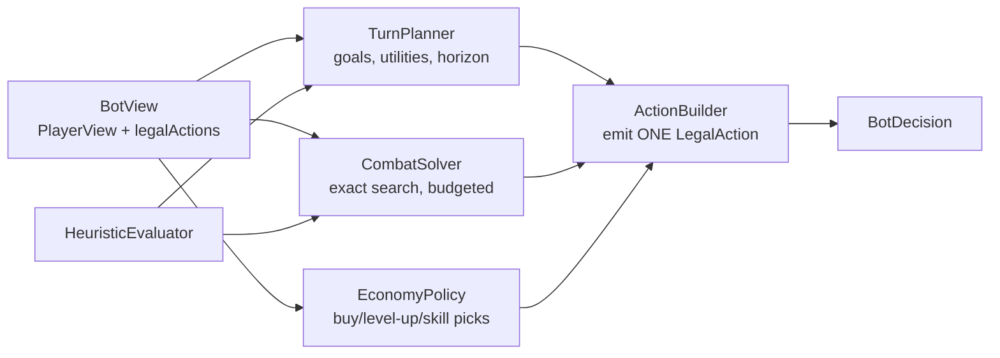

# 13 — Emberwold AI Opponents

**Status:** proposed · **Owner:** architect · **Last updated:** 2026-10-24
**Companions:** [`12-architecture.md`](./12-architecture.md), [`10-feasibility-analysis.md`](./10-feasibility-analysis.md), [`11-mvp-scope.md`](./11-mvp-scope.md) · **Rules source of truth:** [`../research/02-rules-core.md`](../research/02-rules-core.md) (published 2026-10-24; dummy player §17.1, timing/priority/undo §19).
**Tier context:** T1 = *First Conquest* (v1.0 ship target); T2 = *Classic* (Solo Conquest shape, follow-on milestone). `11-mvp-scope.md` is authoritative for scope; tier mapping is in `12-architecture.md` §12.4.

---

## 1. Executive summary

**Recommendation: ship T1/T2 Emberwold without a gameplay AI opponent.** Mage Knight is a solitaire-first design; the "opponent" in the solo scenarios is already specified by the rules as a deterministic dummy-player automaton (`MKUE Rulebook, p.15`), and co-op is 2–4 humans against the map. An AI bot is only needed if the Lead greenlights a PvP/skirmish mode, and even then it should be a **Tier-1 rule-based bot with an exact combat solver** (~5–7 engineer-weeks), not MCTS or a learned policy.

| Tier | What it is | Emberwold fit | Effort | Verdict |
|---|---|---|---|---|
| **0** | No AI: dummy-player clock, static enemies, scripted tutorial | **T1/T2 default** | ~0.5 ew (rules, not AI) | **Ship** |
| **1** | Rule-based goal planner + exact combat solver + utility scoring | PvP sparring bot, hints/advisor, QA self-play | 5–7 ew | **Ship only if PvP mode ships** |
| **2** | MCTS + determinization + move abstraction | Would be needed for a *strong* PvP bot | 5–8 ew + engine hooks | **Defer** |
| **3** | Learned policy (RL/imitation) | Research-grade, no product fit | 12–20 ew + ML ops | **Do not build** |

Three claims anchor this document:

1. **A full-game AI is a research project, not a feature.** At Emberwold's scale a raw game tree has ~10^100+ paths; the best available evidence is the upstream project, which spent 1,255 commits, a Rust engine, PPO/REINFORCE infrastructure and a 352-case evaluation suite — and its best checkpoint still solves **0 of 96 isolated combat drills** under greedy inference, because competent combat needs the exhaustive combat oracle (`packages/python-sdk/evaluation/REPORT.md`). Do not underestimate this.
2. **The highest-value "AI" work in Emberwold is not an opponent.** It is (a) the dummy-player automaton (a rules feature), (b) random/scripted bots for engine QA and balance, (c) an optional hint/advisor system, and (d) the arena/eval harness that makes any bot measurable.
3. **If a bot ships, combat is the solved part and planning is the hard part.** Combat after enemies are revealed is perfect-information, short-horizon and exactly solvable; turn-level planning under hidden information and deckbuilding value is where heuristic bots usually fail.

**Bottom line for the Lead:** decide whether PvP ships. If yes, budget 5–7 ew in Phase 6 and target "fun sparring partner" quality, not expert play. If no, do not build an opponent at all — spend 1–2 ew on the QA/arena harness and (optionally) hints.

---

## 2. What "AI opponent" means in this game

Mage Knight has no official AI opponent. "AI" in this genre is a product decision layered on top of a solitaire design. The modes that matter:

| Mode | Where the "opponent" comes from | AI needed? | Notes |
|---|---|---|---|
| **First Conquest** (T1, v1.0) | Dummy player automaton + map + clock | **No** — rules automaton | 3 rounds, 1 city level 4, simplified dummy (tactics + clock pressure) per `11-mvp-scope` §4–§5 |
| **Classic** (T2 follow-on) | Dummy player automaton + map + clock | **No** — rules automaton | 6 rounds, 2 cities level 5 then 8, dummy flips cards for tempo (`MKUE Rulebook, p.15, p.19`) |
| **Co-op (2–3 heroes)** | Map/cities + dummy player | **No** | Humans coordinate; no enemy decision-making. Official co-op scenarios cap at 3 because of the dummy deck (`MKUE Rulebook, p.15` note 3); Emberwold can vary this |
| **Hotseat / shared screen** | Other humans | **No** | no bot required |
| **PvP skirmish (if greenlit)** | Another hero | **Yes**, Tier 1–2 | PvP rules exist (`MKUE Rulebook, p.12`) but T1/T2 scope excludes them |
| **Hints / advisor** | — | Optional Tier-1 reuse | Highlights good actions; does not play for you |
| **QA / balance** | — | Random + scripted bots | Already required by testing strategy (`12-architecture.md` §10) |
| **Tutorial** | — | Scripted replay | Not AI (`12-architecture.md` §9.5) |

Two clarifications that prevent wasted work:

* **Enemies do not need AI.** Rampaging enemies, garrisons and city defenders are stat blocks with fixed abilities (`MKUE Rulebook, p.8–10, p.24`). "Enemy AI" here would be *scripted tactics* (e.g. block-targeting priorities, summon usage), which only matters if a digital adaptation adds an automated combat referee. Emberwold's engine already resolves them mechanically — no decisions exist.
* **The dummy player is not an AI.** It is a deterministic tempo clock described in the rules: flip 3 cards, check the last color, flip extra cards for matching crystals, end the round when the deck empties (`MKUE Rulebook, p.15`; `MK 2012 Rulebook, p.12`). Implement it in the reducer, event it, and test it like any rule. Don't budget AI time for it.

---

## 3. Why a full-game AI is hard

### 3.1 Branching factor

Emberwold is smaller than MKUE, but the action space is still large because a turn is a *sequence* of card/resource decisions and combat is a resource-allocation puzzle.

| Decision point | Typical legal choices | Worst case | Source of blow-up |
|---|---:|---:|---|
| Tactic selection | 3–6 (kept in T1 per `11-mvp-scope` §5) | 6 | selection phase |
| Play a card (basic / powered / sideways) | 15–30 | ~40 | hand × modes; powered needs mana |
| Move destination | 4–12 | ~20 | move-point flood fill, terrain costs |
| Explore (spend 2 Move) | 0–2 | 2 | adjacency to unexplored slots |
| Site action (interact / enter / burn) | 0–3 | 4 | site type |
| Combat: declare attack targets (ranged/siege) | 1–6 | 8 | target-first, then incremental assignment |
| Combat: block per attacking enemy | 1–4 | 12 | enemy count × attack count |
| Combat: damage assignment | 1–6 | 10 | unit/hero targets, ordered |
| Combat: attack phase declarations | 1–8 | 12 | melee combines all attacks |
| **Full legal-action set at a turn** | **25–90** | **~250** | all of the above together |

Even with a conservative effective branching factor of 10 after macro-action aggregation, a turn is ~10^8–10^12 raw action sequences (8–12 decisions), and a T1 First Conquest game is ~10–15 turns (Classic: ~20–30). The raw tree is astronomically larger than anything MCTS can search without aggressive abstraction. This is not a reason to panic — human players don't search it either — but it is a reason to *never* promise "an AI that plays like a human expert."

Emberwold's reductions help materially: **T1** is one scenario, ~40 card definitions, 1 hero, 4 tiles, one city, 3 rounds; **T2** grows to 11 tiles, ~90–110 cards, 2 heroes, two cities, 6 rounds. But even T1 does not remove hidden information, deckbuilding value, or combat allocation.

### 3.2 Horizon and long-horizon credit assignment

The game's value function is not "gain Fame this turn." It is "be strong enough to conquer the city (cities in T2) before the round limit." Concretely:

* A card gained now (Advanced Action/Spell/Artifact) pays off over the next 1–3 rounds. Myopic scoring systematically under-rates card acquisition, skills, unit recruitment, and crystal/mana setup.
* City assault is a multi-round project: you need attack density (cards/units/spells), mana fixing, and a plan to survive the defense. Human players start preparing 2+ rounds ahead; a 1-ply bot will arrive underpowered and lose.
* Wounds compound: taking 2–3 wounds to clear an optional fight may cost more tempo later through rests and reduced hand size. Risk management is a first-class part of play, not a tie-breaker.
* Tempo is interactive even in solo: the dummy player sets the round's pace; racing to End of Round denies you value, playing too slowly lets the dummy end it. Time pressure is part of the objective.

An evaluation function must compress all of this into a number. That's the hardest part of a heuristic bot and the part that is easy to tune into a local optimum.

### 3.3 Hidden information

| Information | Hidden from whom | Effect on planning |
|---|---|---|
| Order of your own Deed deck | You (draws are random) | Can't guarantee drawing the attack card you need; plan in probabilities |
| Tile deck order / core city tile selection | Everyone | Exploration is a gamble on what site/reward appears |
| Enemy token piles (color pools) | Everyone until revealed | Combat difficulty unknown before entering a site |
| Source die rolls each round + effect dice | Everyone until rolled | Mana availability uncertain; powered cards are not guaranteed |
| Enemy dungeon/tomb/monastery tokens | Revealed only when fought | Risk/reward of adventure sites |
| Opponent hand/deck, and who may act in each effect window (`02-rules-core.md` §19.1) | Opponent | PvP requires belief modelling → determinization; even solo uses commit-point semantics for information timing |

For a solo bot, hidden information is mostly *future randomness*, which can be handled reasonably by expected-value planning (sample deck draws, tile/site distributions) without full determinization. For PvP, it is *adversarial* hidden information and needs determinization or information-set search — an order of magnitude harder. This is a key reason any first bot should be built for solo/sparring, if at all.

### 3.4 Non-stationarity and action-space growth

The bot's action space changes as it gains cards, skills, units, and mana. A policy trained or hand-tuned in round 1 sees different cards in round 4. Upstream's legal-action module handles ~70 action variants and its effect engine 100+ effect types; Emberwold's subset is smaller but still grows through play. Any learned policy must handle combinatorial generalization; a heuristic bot just needs a card-value table and a planner that reacts to whatever `legalActions` says. This is a major reason Tier 1 is the right first bot: it does not need to learn the action space.

### 3.5 What "good play" even is

There is no single scalar during play: Fame matters, but city conquest and round efficiency dominate the score. T1 First Conquest uses tuned Fame + achievement weights (`11-mvp-scope` §4.1); T2/Classic uses the official Solo Conquest table (`MKUE Rulebook, p.19`: 10 points/city, +15 for all cities, 30 per unused round, dummy-deck and end-of-round bonuses, plus achievements). Two bots can have similar Fame and vastly different scores. Evaluation must use the **scenario scoring function**, not Fame alone, and must report completion separately. This matters for both bot tuning and honest reporting to the Lead.

### 3.6 Evidence from the upstream project

The upstream Mage Knight project is the strongest available evidence about what it takes to build this kind of AI:

| Evidence | What it shows |
|---|---|
| Rust workspace (8 crates measured) + **2,459** Rust tests; TS engine built first, then rewritten (`../research/05-digital-precedents.md` §1.2–§1.3) | Even the engine alone is a large multi-month effort; they built it before serious AI work — and wrote it twice |
| PPO/REINFORCE training infra, PyO3, vectorized environments (`packages/python-sdk/README.md`) | Learned policies need an entire training stack, not a script |
| `mk-solo-skill-v1`: 352 held-out cases, high-bit seed namespace, leaderboard, promotion gates (`evaluation/README.md`) | Real AI evaluation is a product-grade harness — a bot without this is unmeasurable |
| Random baseline: **0.0%** core completion, score −10.30; best checkpoint: **95.3%** completion (`evaluation/REPORT.md`) | Random play is hopeless; learned play can complete the scenario — but see next row |
| Best checkpoint solves **0/96 combat drills** under greedy inference; v13 solves 2/96; project relies on an exhaustive combat oracle | Full-game competence does not imply tactical competence; combat needs search |
| `mk-combat-search`: exhaustive DFS vs MCTS benchmark; DFS uses transposition tables, pruning, node limits (default 10M) | Even a *single* combat is a search problem large enough to need engineering |
| Standalone `BatchedMCTS` exists but is **not** wired to training; docs warn that the cheap combat resolver has a deterministic pessimistic bias that MCTS cannot average away | MCTS in this game is an open research item, with known safety caveats, even for the reference implementation |
| 1,255 commits / 4 contributors / no releases / 147 open issues / no LICENSE (Lead update, 2026-10-24) | Deep engine, no shipped product: the AI is part of a long research tail, not a shipping multiplier |

**Implication:** the realistic quality bar for a Emberwold bot is "fun sparring partner / credible opponent for casual players," not "beats experienced humans." Plan and communicate accordingly.

---

## 4. Tiered approach

### 4.1 Tier 0 — No AI (recommended for T1/T2)

**Scope**
* Dummy player automaton for solo/co-op tempo (`MKUE Rulebook, p.15`), implemented in the reducer, with events (`dummyCardsFlipped`, `dummyCrystalsChanged`, `roundEndAnnounced`).
* Static enemies/sites (no decision-making).
* Scripted tutorial replay and QA bots (random legal, scripted traces).

**Why it is right for T1/T2:** the brief's reduction axes are solo/co-op first (`00-brief.md` §5); the game's own solo mode is defined without a decision-making opponent; a bot is a *new mode*, not a missing piece of the core scenario.

**Effort:** 0.5 ew for the dummy automaton (part of Phase 1, not AI budget) + 1–1.5 ew for the arena/QA harness (already required by `12-architecture.md` §10.3).

**Acceptance:** dummy-player traces produce exactly the rulebook behavior; random-legal bot runs 2,000 games nightly; no crashes, invariants clean.

### 4.2 Tier 1 — Rule-based planner + exact combat solver (recommended if PvP ships)

This is the "honest game AI" tier: deterministic, cheap, explainable, fast, testable, and tunable. Architecture:



**Component 1 — CombatSolver (the crown jewel).**
Combat after enemies are revealed is perfect information: known hand, units, skills, mana, enemies, phase. Solve it with bounded DFS/A* over combat actions, a transposition table (hash combat-relevant state), and the engine's incremental action model (`12-architecture.md` §5.7). Score lines by an explicit evaluation function, e.g.:

```
score = 100 × fameGained
      − 80  × woundsTaken
      + 15  × nonWoundCardsRemaining
      − 25  × crystalsSpent
      − 40  × unitsNewlyWounded
      − 500 × knockout
```

(These weights are illustrative; the upstream combat-search tool uses a similar structure — fame positive, wounds/knockout/crystals/units negative — and is cited as evidence that the shape works, not as code to copy.) Budget: 50k–500k nodes or 100–300 ms; fall back to greedy allocation if budget is exhausted. Because combat is deterministic, a solved line can be cached per (combat, hand, resources) and reused in rollouts.

**Component 2 — TurnPlanner.**
Enumerate *goals*, score them, then emit actions toward the best one, re-planning after every action (because exploration/combat reveal information):

| Goal | Utility signals | Feasibility check |
|---|---|---|
| Conquer/assault city | progress toward objective (huge), fame, rewards | army strength vs garrison (solver), move distance |
| Clear rampaging enemy | fame, reputation, access to space, risk | solver score > threshold |
| Explore toward city/unknown | expected site value, distance to city, dummy tempo | move points, tile adjacency |
| Interact (recruit/heal/learn/buy) | deck/army improvement, wound removal | influence total, site type, offers |
| Level up / collect rewards | skill/card value | pending rewards |
| Rest / heal | avoid knockout, regain cards | wounds in hand/units |
| End round / tempo | dummy deck state, remaining value | round phase, deck state |

Utility scoring is hand-tuned with tunable weights per difficulty level; expose them in config so balance is data, not code.

**Component 3 — EconomyPolicy.**
Static value tables for cards/units/skills (attack density, block, movement, mana fixing, draw, healing), purchase priority by deck need, level-up reward choice, crystal/mana spending policy (when to power a card vs save a crystal), and buy-order heuristics at villages/monasteries/mage towers. All data-driven from content so balance changes don't require code.

**Component 4 — RiskPolicy.**
Wound/knockout avoidance thresholds, "don't take a 40% fight for 2 Fame" logic, rest timing, and a tempo policy relative to the dummy deck (race vs value).

**What Tier 1 does not do:** multi-round lookahead over future card gains, PvP opponent modelling, or full determinization. It plans the current turn against the current objective and replans; that is enough for a credible casual opponent.

**Effort breakdown**

| Work | ew | Notes |
|---|---:|---|
| Combat solver (DFS + transposition + eval + budget fallback) | 1.5–2 | highest value/effort ratio; reusable as a hint engine |
| Turn planner + heuristic evaluator | 2–3 | the risky part; cap scope to goal scoring + receding horizon |
| Economy/level-up/purchase policy | 0.5–1 | mostly data tables |
| Bot config/difficulty + UI integration | 0.5–1 | bot mode, thinking indicator, speed |
| Arena harness + evaluation report (shared with QA) | 1–1.5 | also useful without a bot |
| **Total** | **5–7** | fits `12-architecture.md` Phase 6 (4–6 ew) if the arena is already counted in QA |

**Acceptance criteria for a shipped Tier-1 bot**
* Emits only legal actions: 0 rule violations over 10,000 games (by construction — it picks from `LegalActionSet`).
* Completes the tuned Emberwold scenario on a meaningful fraction of seeds at "normal" (target: measure first; a reasonable initial bar is ≥40–60% — calibrate after the harness exists rather than promising a number now).
* Beats RandomLegal ≥95% and a GreedyCombat baseline ≥65% in the arena.
* p95 decision time ≤ 500 ms per action (≤2 s occasionally); never stalls a human's turn visually (thinking indicator + budget cap).
* Deterministic given a seed; fair (uses `BotView` only, never omniscient state).
* Human playtest: 8/10 sampled bot turns are "not obviously nonsensical"; casual players describe it as a credible opponent; no complaints about cheating.

### 4.3 Tier 2 — MCTS with determinization and abstraction (defer)

Only worth it if the product needs a *strong* PvP bot or a best-move advisor for experienced players. Design sketch:

* **Prerequisites in engine:** cheap state fork/clone (structural sharing), `createDeterminization(state, viewer, rng)` in a server/AI-only package, action-space macros, fast combat solver as leaf evaluator.
* **Determinization:** sample hidden information consistent with the viewer's knowledge — their deck order (shuffle unknown cards), tile deck, enemy token piles, future source dice. Each determinization becomes a perfect-information game; average results (Perfect Information Monte Carlo) or maintain beliefs (information-set MCTS). Beware *strategy fusion* (over-trusting sampled information) and the "averaging over impossible worlds" bias.
* **Abstraction:** root children = turn-plan macros (from the Tier-1 planner: "go assault city", "explore west", "recruit at village"); not individual card plays. Within combat, do **not** MCTS — solve exactly with the Tier-1 solver; this avoids the upstream-documented bias problem where a cheap combat resolver's pessimism contaminates search.
* **Chance handling:** either determinize, or model explicit chance nodes for dice/draws (better, needs engine support for sampling without mutating state).
* **Budget:** 0.5–2 s per turn, 1k–10k iterations; still far too slow for a snappy casual game at higher budgets — use only for a "strong" difficulty or async/advisor mode.
* **Expected gain:** uncertain. In high-variance deckbuilders, MCTS+determinization often struggles to beat a well-tuned heuristic; measure against Tier 1 before committing.
* **Effort:** 2–3 ew spike (prove or kill) / 5–8 ew productionised, plus engine hooks.
* **Evidence:** upstream has a standalone `BatchedMCTS` and explicitly documents a safety requirement around combat-resolution bias; it is not wired into their training loop. This is a research area, not a solved feature.

### 4.4 Tier 3 — Learned policy (do not build)

Two variants, both poor fits for Emberwold T1/T2:

| Approach | Requirements | Why not now |
|---|---|---|
| **RL from scratch** (PPO/IMPALA) | Rust/optimized engine for throughput, feature/action encoders, vectorized envs, GPU training, frozen eval suite, months of iteration | Upstream needed a 6-crate Rust engine, PPO infra, 180k+ episodes, and still relies on oracles for combat; Emberwold's content will churn during balance, invalidating checkpoints; effort 12–20 ew + ongoing MLOps |
| **Imitation learning** from human playtests | Thousands of logged games with action labels, a feature encoder, eval harness, data pipeline + privacy policy | Data doesn't exist yet; collecting it takes months; re-tuning after balance changes is expensive; still needs the Tier-1 solver for combat quality |
| **LLM-based agent** | API costs, latency, nondeterminism, rules hallucination risk | Unacceptable for a rules engine; might be acceptable *only* for natural-language hint narration, not action selection |

**When to revisit:** after launch, if PvP is a core mode, there is a large opt-in replay corpus, and a dedicated ML engineer. Even then, start with behavior cloning + a small value model, not PPO.

### 4.5 Tier comparison

| Dimension | Tier 0 | Tier 1 | Tier 2 | Tier 3 |
|---|---|---|---|---|
| Effort | 0–1.5 ew | 5–7 ew | +5–8 ew (and engine hooks) | 12–20 ew + MLOps |
| Predictability of schedule | high | medium | low | very low |
| Decision quality | optimal play not needed | casual-human-ish, weak late game | potentially near-heuristic+ | unknown; likely weak tactics without solver |
| Explainability | trivially fair | high (weights, logs) | low | low (black box) |
| Runtime | — | ms | 0.5–2 s/turn | ms (policy) but training cost |
| Maintenance | trivial | moderate | high | very high |
| Fit for Emberwold T1/T2 | **◎** | △ (only if PvP) | ✕ | ✕ |

---

## 5. Bot interfaces (implementation-grade)

These live in `packages/ai` and depend on `engine` + `shared` only (`12-architecture.md` §4.2). Bots never see `GameState`; they see a projection, by construction.

```ts
// ---- What a bot may see (fair play enforced by type) ----
export interface BotView extends PlayerView {
  readonly legalActions: LegalActionSet;
  readonly content: BotContent;            // names, categories, static effect summaries
  readonly scenario: ScenarioSummary;      // rounds left, cities left, objective
  readonly belief?: BeliefState;           // Tier 2 only: sampled hidden state
}

// ---- Bot contract ----
export interface BotRng { nextInt(maxExclusive: number): number; } // separate from game RNG
export interface BotConfig {
  readonly id: string;                     // "heuristic-v1"
  readonly difficulty: "apprentice" | "knight" | "mageKnight";
  readonly budgetMs: number;               // hard wall per decision
  readonly solverBudget: number;           // node cap for combat search
  readonly horizon: "action" | "turn" | "round";
  readonly mistakeRate: number;            // 0..1, probability of choosing k-th best
  readonly weights: HeuristicWeights;      // tunable via config, not code
}
export interface BotDecision {
  readonly action: LegalAction;            // must come from view.legalActions
  readonly plan?: PlanSummary;             // for debug/telemetry
  readonly nodesEvaluated?: number;
  readonly elapsedMs: number;
}
export interface Bot {
  readonly config: BotConfig;
  decide(view: BotView, rng: BotRng): BotDecision;   // synchronous, budgeted
}

// ---- Combat solver ----
export interface CombatInput {
  readonly combat: CombatView;             // enemies, phase, accumulated pools
  readonly hand: readonly CardView[];
  readonly units: readonly UnitView[];
  readonly skills: readonly SkillView[];
  readonly mana: ManaAvailability;
  readonly objective: CombatObjective;     // fame first, wounds threshold, survive
}
export interface CombatSolution {
  readonly score: number;
  readonly line: readonly LegalAction[];   // to be executed by the caller through real engine
  readonly expected: CombatExpectation;    // fame, wounds, cards, resources
  readonly complete: boolean;              // false = budget exhausted, greedy fallback
  readonly nodes: number;
}
export interface CombatSolver {
  solve(input: CombatInput, budget: number): CombatSolution;
}

// ---- Turn planner ----
export interface Goal {
  readonly kind: "assaultCity" | "clearRampaging" | "explore" | "interact" | "reward" | "rest" | "tempo";
  readonly target?: Hex | SiteId;
  readonly utility: number;
  readonly notes: readonly string[];
}
export interface TurnPlanner {
  proposeGoals(view: BotView): readonly Goal[];
  scoreGoal(view: BotView, goal: Goal): number;
  nextAction(view: BotView, goal: Goal): LegalAction | null; // null = goal infeasible
}

// ---- Tier 2 only: determinization ----
export interface DeterminizationSampler {
  /** Sample a full hidden state consistent with `view`; never exposed to client bundle. */
  sample(state: GameState, viewer: PlayerId, rng: BotRng): GameState;
}
```

Implementation notes:
* `BotDecision.action` is an element of `view.legalActions.actions`; the bot should assert index membership in dev builds. This makes "illegal action" bugs impossible by construction and keeps arena legality error rate at 0.
* Difficulty is a **config diff**, not a code fork. `mistakeRate` chooses the k-th best action with probability ε (k tuned per difficulty); horizon truncates planner lookahead; solver budget degrades search quality. No stat cheats, no extra mana, no peeking at hidden information.
* All bot decisions and internal scores are logged to the replay/telemetry stream (opt-in) so failures can be debugged from a trace.

---

## 6. Difficulty scaling

Difficulty should come from **decision quality and scenario knobs**, never from hidden-state cheating. Cheating bots are harder to test, break replay fairness, and players notice.

| Knob | Values | Effect | Cost |
|---|---|---|---|
| Bot tier | none / Tier 1 / Tier 2 | qualitative strength change | tier cost |
| Planning horizon | current action / current turn / current round | long-horizon competence (city preparation) | planner complexity |
| Combat solver budget | greedy / 10k / 100k / 500k nodes | tactical quality | runtime only |
| Mistake rate ε (and rank k) | 0 / 0.05 / 0.15 / 0.3 | deliberate blunders; the most controllable knob | trivial |
| Heuristic weights | fame vs wounds vs tempo vs economy | play style (aggressive/cautious) | data |
| Economy efficiency | optimal / greedier / suboptimal purchases | deck strength over time | data |
| Determinizations (Tier 2) | 1 / 8 / 32 | search quality | runtime |
| Thinking delay | 0 / 300 ms / 800 ms | UX pacing (artificial, for "feel") | trivial |
| Scenario difficulty | city levels, rounds, tile counts | official rules mechanism (`MKUE Rulebook, p.19` variants) | data |

Recommended launch ladder (if bot ships): **Apprentice** (ε=0.25, greedy solver, action horizon), **Knight** (ε=0.08, 50k solver nodes, turn horizon), **Mage Knight** (ε=0, full solver budget, round-aware planner). Calibrate each after the arena exists; publish expected win rates rather than guessing.

---

## 7. Evaluation methodology

A bot without an arena is unfalsifiable. The arena is shared with QA and is **worth building even if no bot ships** (random-legal fuzz and scripted regression bots need it).

### 7.1 Arena harness

```ts
export interface ArenaMatchConfig {
  readonly matchId: string;
  readonly contentHash: string;
  readonly scenarioId: string;
  readonly seed: number;
  readonly seats: readonly BotSpec[];      // 1 bot for solo scoring runs, 2+ for PvP
  readonly maxActions: number;             // guard
}
export interface MatchRecord {
  readonly config: ArenaMatchConfig;
  readonly outcome: "bot0Win" | "bot1Win" | "draw" | "completion" | "timeout" | "crash";
  readonly scores: readonly number[];      // official scenario scoring
  readonly rounds: number;
  readonly actions: number;
  readonly wounds: readonly number[];
  readonly wallMs: number;
  readonly legalityErrors: number;         // must be 0
}
```

* Node `worker_threads` pool; each game is independent and deterministic (seed + content hash).
* Output NDJSON; a `report` command aggregates (mean/median/percentiles, Wilson intervals, paired win/loss/draw, Bradley–Terry ratings) and writes a markdown leaderboard.
* Every match is replayable: the record contains a save-compatible action log (`12-architecture.md` §7.2).
* CI: nightly arena for bot changes; not on every PR (too slow). Promotion gates on milestone builds.

### 7.2 Baselines and anchors

Use fixed anchors, as upstream does, so ratings don't drift:

| Anchor | What it measures |
|---|---|
| `random-legal` | legal-action coverage and crash resistance |
| `scripted-tutorial` | regression on the tutorial line and simplest competent play |
| `greedy-combat` | solver-only baseline (fights well, plans badly) — isolates planner value |
| `heuristic-vN` | previous shipped bot (monotone improvement check) |
| `human-playtest` | external validity (small N, reported separately) |

### 7.3 Metrics

| Metric | Why |
|---|---|
| Scenario score (T1 tuned / Classic official) | The actual objective (`11-mvp-scope` §4.1; `MKUE Rulebook, p.19` for Classic); Fame alone hides city/round bonuses |
| Scenario completion | Binary success — the T1 city / both Classic cities |
| Rounds used / "time to city" | Tempo quality |
| Wounds taken / knock-outs | Risk management |
| City assault success rate | Late-game competence |
| Actions per turn / boundary loop rate | Sanity (no infinite loops, no passivity) |
| Legality errors | Must be 0 |
| p50/p95 decision latency | UX budget |
| Crash/timeout rate | Robustness |

### 7.4 Statistical protocol

* **Paired seeds**: evaluate candidate vs anchor on the *same* seed set; compare per-seed outcomes (win/loss/tie, score delta). This is far more sensitive than unpaired means in a high-variance game.
* **Holdout seeds**: tuning uses seeds `1..N`; evaluation uses a disjoint high-bit namespace (e.g. `seed >= 2^31`), mirroring upstream's frozen-suite design. Never tune on eval seeds.
* **Sample size**: ≥200 games per pairing for coarse win rates, ≥1,000 for promotion decisions; report 95% Wilson intervals, not bare percentages.
* **Regression gates** (borrowed in spirit from upstream's leaderboard policy, thresholds illustrative): candidate fails if completion drops >5 percentage points, mean score drops >2 points, or it loses >55% of paired cases against the current anchor. Gates live in CI config.
* **Ablations**: solver on/off, horizon depth, ε, determinization count — each measured, not assumed.

### 7.5 Task-specific drills

Full-game metrics hide weaknesses; use short fixed drills (same engine, seeded positions):

* **Combat drills**: basic attack, powered attack, fortified enemy, multi-enemy allocation, block/resistance math, unit-assisted combat, damage assignment/wounds. (Upstream's suite has 96 combat drills precisely because full-game competence doesn't imply combat skill — `evaluation/README.md`.)
* **Exploration drills**: reach a target site within a move budget, choose explore direction, avoid provocation.
* **Economy drills**: influence purchases, level-up choice quality, deck thinning.
* **Endgame drills**: city assault from a prepared position; time-to-city benchmarks.

### 7.6 Human evaluation

* 5–10 playtesters × 3 difficulty levels, blind ordering, short survey: fun, fairness, perceived strength, confusion, "did the bot do anything nonsensical?" (free text).
* Observe sessions; log replays (with consent) as future evaluation/IL data.
* Compare against the stated design target (e.g. "new players win ~50% on Apprentice, lose ~70% on Knight") — adjust knobs, not the game.

---

## 8. MVP recommendation and effort

### 8.1 Recommended plan

| Scenario | Recommendation | Effort | Calendar (with 2 engineers) |
|---|---|---|---|
| **No PvP in T1/T2** (recommended) | Ship Tier 0: dummy automaton (rules) + arena/QA bots + optional hints later. No AI opponent. | 1–1.5 ew for harness (already in QA); 0 for AI | 0 additional |
| **PvP sparring bot in a future mode** | Tier 1 only: exact combat solver + turn planner + 3 difficulty levels; no MCTS, no learning | 5–7 ew | +3–4 weeks on the Phase 6 slot (T3) |
| **Strong PvP bot / advisor** | Tier 1 + a bounded Tier-2 spike; ship only if it beats Tier 1 in the arena | 8–12 ew + engine hooks | +5–7 weeks, high schedule risk |
| **Learned policy** | Do not build for T1/T2 | 12–20 ew + MLOps | not scheduled |

### 8.2 Phased AI milestones (if greenlit)

1. **Arena + baselines** (1.5 ew, can start in Phase 0): random legal bot, NDJSON records, report, seed harness. *Exit: 100 games run, zero crashes.*
2. **Combat solver** (2 ew, after Phase 1): solves constructed combat drills; integrates into a "combat-only" bot. *Exit: beats greedy allocation on 30/40 drills.*
3. **Turn planner** (2–3 ew, after Phase 2): goal scoring + receding horizon; economy tables. *Exit: completes scenario on 30%+ of eval seeds; no stalls.*
4. **Difficulty + integration** (1 ew): configs, UI bot mode, telemetry. *Exit: 3 levels, human playtest round 1.*
5. **Promotion gate** (milestone): paired arena vs anchors, human feedback, then ship. *Exit: acceptance criteria §4.2 met or cut the bot.*

### 8.3 Decision checklist for the Lead

| ID | Decision | Recommendation | Cost/impact |
|---|---|---|---|
| **D-AI-1** | Does an AI opponent ship in T1/T2 at all? | **No**, unless PvP is greenlit. Solo/co-op don't need it. | Avoids 5–12 ew of high-risk work |
| **D-AI-2** | If yes, what quality bar? | "Credible casual sparring partner," 3 levels; do not promise expert play | Sets expectations; prevents scope creep |
| **D-AI-3** | Bot fairness model | Fair: `BotView` only, difficulty via decision quality; never omniscient | Cheap; keeps replays/eval honest |
| **D-AI-4** | MCTS spike? | **No** before Tier 1 ships; optional 2–3 ew spike afterward, kill if it doesn't beat Tier 1 | Schedule protection |
| **D-AI-5** | Learned policy? | **No.** Revisit post-launch only with opt-in replay corpus + ML engineer | Avoids 12–20 ew |
| **D-AI-6** | Hints/advisor in T1/T2? | Optional, small: reuse planner to highlight 2–3 actions; 1–2 ew | Good value for new players |
| **D-AI-7** | Who owns arena/eval infra? | Engine team in Phase 0–1; it is QA infrastructure, not AI-only | 1–1.5 ew, pays back in testing |
| **D-AI-8** | Telemetry for future AI? | Add opt-in replay upload from playtests; versioned content hash; privacy review | Cheap now, valuable later |
| **D-AI-9** | Scenario difficulty vs bot difficulty | Keep them separate: scenario difficulty is rules data (city levels; Classic variants `MKUE Rulebook, p.19`); bot difficulty is decision quality | Clear player-facing model |

---

## 9. Risks and what could sink the AI work

| # | Risk | L | Impact | Mitigation |
|---|---|---|---|---|
| R-AI1 | **Planner time sink**: heuristic bots are never "done"; endless tuning | High | High | Fixed timebox per milestone; acceptance criteria up front; cut to solver-only if planner slips |
| R-AI2 | **Expectation mismatch**: players expect a strong/deep opponent, get a casual one | Med | High | Position as "sparring partner"; 3 difficulty levels; measure human win rates before launch |
| R-AI3 | **Evaluation noise**: small samples, high variance → false improvements | High | Med | Paired seeds, ≥200–1,000 games, CI intervals, holdout seed namespace, frozen anchors |
| R-AI4 | **Content churn invalidates tuning** | High | Med | Data-driven weights; re-run arena after content changes; freeze content for bot tuning windows |
| R-AI5 | **Bot cheating / hidden-info leaks** | Med | High | `BotView`-only type boundary; hidden-info property tests; no omniscient imports in bot package |
| R-AI6 | **MCTS/learned rabbit hole** | Med | High | Explicit "no" for T1/T2; any spike has a kill criterion and timebox |
| R-AI7 | **Runtime**: bot turn slow enough to hurt feel | Med | Med | Budget caps, incremental search, cache, thinking indicator, instant mode for low difficulty |
| R-AI8 | **Maintenance burden**: bot breaks with every rules/content change | Med | Med | Arena regression suite; bot reads legal actions (not rules); data tables versioned with content |
| R-AI9 | **Fairness perception in PvP**: bot appears to know too much or gets lucky | Low | Med | Fair view; replay logs; transparent difficulty |
| R-AI10 | **Advisor/hints creep** into tutorial/AI product scope | Low | Med | Hints are optional and reuse the bot; not a T1/T2 requirement |

**The honest failure mode:** the bot is not hard because combat is hard — combat is exactly solvable. It is hard because *long-horizon planning under hidden information with a deckbuilding value function* is genuinely hard, and a casual game has a low tolerance for a bot that plays well but slowly or inexplicably. A shipped bot should be small, fast, fair, and measured; a research-grade bot should not be in the T1/T2 critical path.

---

## Sources

**Primary rules**
- `reference/extracted/MKUE_rulebook.txt` — p.4 (deed cards / play modes), p.6 (a player's turn), p.8–10 (combat phases, damage, outcomes), p.12 (PvP), p.15 (dummy player), p.19 (Solo Conquest setup/end/scoring), p.24 (combat ability reference).
- `reference/extracted/MK_base_rulebook_2012.txt` — Scenario Book p.12 (dummy player), p.17 (Solo Conquest).
- `reference/extracted/MKUE_walkthrough.txt` — p.2 (rounds/turns and learning flow).
- `docs/research/00-brief.md` — scope framing and reduction axes (§5), AI/search expectations for design docs.

**Upstream prior art** (pinned commit `4d39368c5dc48b6d780dad05f871937b436604d5`, 2026-10-23, per [`../research/05-digital-precedents.md`](../research/05-digital-precedents.md) §1.1; no LICENSE file — patterns and findings cited, no code, fixtures, or data copied)
- https://github.com/mage-knight-digital/MageKnight — repository (Rust engine + React client).
- https://github.com/mage-knight-digital/MageKnight/blob/main/packages/python-sdk/README.md — RL training (REINFORCE/PPO), batched MCTS, combat-oracle caveat, benchmark commands.
- https://github.com/mage-knight-digital/MageKnight/blob/main/packages/python-sdk/evaluation/README.md — 352-case frozen suite, seed namespace, leaderboard, promotion gates, adaptive curriculum.
- https://github.com/mage-knight-digital/MageKnight/blob/main/packages/python-sdk/evaluation/REPORT.md — random 0.0% vs 95.3% completion; combat-drill weakness (0/96 for two pilots, 2/96 for v13); suite runtime and throughput.
- https://github.com/mage-knight-digital/MageKnight/blob/main/packages/python-sdk/evaluation/leaderboard/mk-solo-skill-v1/leaderboard.md — leaderboard table.
- https://github.com/mage-knight-digital/MageKnight/blob/main/packages/python-sdk/evaluation/baselines.json — frozen anchors and promoted champion checkpoint.
- https://github.com/mage-knight-digital/MageKnight/blob/main/packages/engine-rs/tools/mk-combat-search/src/main.rs — exhaustive DFS vs MCTS combat-search benchmark; transposition tables, pruning, node limits, heuristic combat scoring.
- https://github.com/mage-knight-digital/MageKnight/blob/main/packages/engine-rs/CLAUDE.md — engine/AI crate layout; legal-action and effect-queue architecture.
- Lead update (2026-10-24): 1,255 commits, 4 contributors, no releases, 147 open issues, no LICENSE.

**Companion docs**
- [`../research/05-digital-precedents.md`](../research/05-digital-precedents.md) — measured prior-art/legal analysis (repo facts, architecture patterns, UX failures).
- [`10-feasibility-analysis.md`](./10-feasibility-analysis.md) — feasibility verdict, effort model, gates (Lead).
- [`11-mvp-scope.md`](./11-mvp-scope.md) — authoritative T1/T2 scope, content manifest, scenarios (Lead).
- [`12-architecture.md`](./12-architecture.md) — engine/legal-action API, testing, performance budgets, tier mapping, phased plan.
- [`../research/02-rules-core.md`](../research/02-rules-core.md) — engine-facing rules spec; §17.1 (dummy player), §19 (effect windows, simultaneous resolutions, undo) are the bot/arena ground truth.
- [`../research/06-legal-ip.md`](../research/06-legal-ip.md) — IP/legal posture (complete; relevant to using upstream code).
